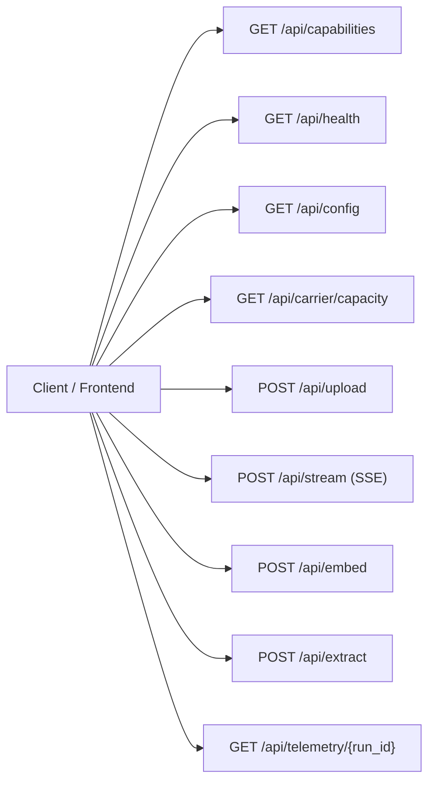

# PaladinMedia — Frontend/Backend API Contract Specification

**Document Version:** 3.0.0  
**Date:** 2026-11-02  
**Classification:** API Interface Specification  
**Status:** PRODUCTION CONTRACT APPROVED

---

## 1. Overview & Transport Protocol

PaladinMedia exposes an asynchronous, event-driven REST and Server-Sent Events (SSE) API designed for real-time post-quantum steganography execution, transform-domain inspection, and sustainable computing telemetry.

### 1.1 Base URL & Environment Discovery
- **Environment Variable:** `VITE_API_BASE_URL` (configured during frontend build or deployment).
- **Default Localhost Fallback:** `http://localhost:8000`.
- **Cloud Remote Fallback:** When deployed to production, client defaults to the origin hostname or configured Render URL.
- **Content Types:**
  - Standard Requests: `application/json`
  - Uploads: `multipart/form-data`
  - Streaming Pipeline: `text/event-stream`
  - Health & Probes: `application/json`

---

## 2. API Endpoint Catalog



---

## 3. Detailed Endpoint Contracts

### 3.1 Capabilities Discovery
- **Path:** `GET /api/capabilities`
- **Auth:** Optional in local development; enforced in remote deployment if `REQUIRE_AUTH=true`.
- **Response (200 OK):**
```json
{
  "status": "OPERATIONAL",
  "system_title": "PaladinMedia",
  "subtitle": "Post-Quantum Media Steganography & Wavelet Core",
  "active_engine": "neural_spatial_onnx",
  "available_engines": [
    {
      "id": "neural_spatial_onnx",
      "name": "Neural Spatial ONNX (Qualified)",
      "description": "Production opset14 spatial ONNX model with internal Haar DWT/IDWT",
      "status": "QUALIFIED",
      "is_default": true
    },
    {
      "id": "acs_sub_inn_onnx",
      "name": "ACS-Sub-INN Subband ONNX",
      "description": "Transform-domain subband INN model with explicit Python 2D Haar DWT/IDWT",
      "status": "QUALIFIED",
      "is_default": false
    },
    {
      "id": "acs_sub_inn_pytorch",
      "name": "ACS-Sub-INN PyTorch Reference",
      "description": "Native PyTorch ACSSubINN + NeuralSpatialBridge reference implementation",
      "status": "REFERENCE",
      "is_default": false
    },
    {
      "id": "parity_classical",
      "name": "Deterministic Parity Modulation",
      "description": "Classical Phase 2 integer parity transform-domain modulation",
      "status": "LEGACY_FALLBACK",
      "is_default": false
    }
  ],
  "default_protocol_version": 2,
  "supported_protocol_versions": [2, 3],
  "ecc_profile": "rs_2t_48",
  "supported_ecc_profiles": ["rs_2t_48", "rs_2t_32"],
  "telemetry": {
    "available": true,
    "source": "estimated_hardware_model",
    "is_estimated": true,
    "metrics_tracked": [
      "execution_time_ms",
      "cpu_utilization_percent",
      "memory_rss_mb",
      "estimated_power_watts",
      "energy_kwh",
      "co2_emissions_grams"
    ]
  },
  "pipeline_stages": [
    {"id": "LOAD", "name": "Load Media", "domain": "io"},
    {"id": "SERIALIZE", "name": "Payload Serialization (CRC-32)", "domain": "framing"},
    {"id": "ENCRYPT", "name": "AES-256-GCM Encryption", "domain": "crypto"},
    {"id": "RS_ENCODE", "name": "Reed-Solomon ECC Encoding", "domain": "ecc"},
    {"id": "CAPACITY_CHECK", "name": "Carrier Capacity Hard Gate", "domain": "gate"},
    {"id": "DWT", "name": "1-Level 2D Haar DWT", "domain": "wavelet"},
    {"id": "EMBED", "name": "Transform-Domain Modulation", "domain": "modulation"},
    {"id": "IDWT", "name": "Inverse DWT & PNG Synthesis", "domain": "wavelet"},
    {"id": "RECEIVER_DWT", "name": "Receiver Stego DWT", "domain": "wavelet"},
    {"id": "EXTRACT", "name": "Header & Payload Extraction", "domain": "demodulation"},
    {"id": "RS_DECODE", "name": "Reed-Solomon Error Correction", "domain": "ecc"},
    {"id": "AES_VERIFY", "name": "AES-GCM Tag Verification", "domain": "crypto"},
    {"id": "SECRET_RECOVER", "name": "Secret Media Reconstruction", "domain": "framing"},
    {"id": "EXACT_MATCH_VERIFY", "name": "Exact Byte Equality Verification", "domain": "verification"}
  ],
  "onnx_models_verified": true,
  "max_upload_size_bytes": 10485760,
  "max_carrier_dimension": 2048,
  "max_carrier_pixels": 4194304
}
```

---

### 3.2 Health & Probes
- **`GET /api/health`**: Overall operational status. Returns 200 if operational, 503 if degraded.
- **`GET /api/health/live`**: Liveness probe returning `{"status": "live", "live": true}`.
- **`GET /api/health/ready`**: Readiness probe returning `{"status": "ready", "ready": true}` if ONNX hashes and pipeline are verified.

---

### 3.3 Dynamic Capacity Calculation
- **Path:** `GET /api/carrier/capacity?width={w}&height={h}`
- **Validation:** $w, h \ge 32$, $w \pmod 2 = 0$, $h \pmod 2 = 0$, $w \times h \le 4\text{ Mpx}$.
- **Response (200 OK):**
```json
{
  "carrier_width": 512,
  "carrier_height": 512,
  "subband_height": 256,
  "subband_width": 256,
  "ecc_profile": "rs_2t_48",
  "ecc_parity_symbols": 48,
  "carrier_format_policy": "Lossless 8-bit RGB PNG only.",
  "raw_secret_capacity_bytes": 6578,
  "reference_metadata_capacity_bytes": 100,
  "max_protected_bytes": 6578,
  "is_qualified_deployment": true,
  "operational_qualification_note": "Qualified ONNX deployment active"
}
```

---

### 3.4 Media Upload & Session Management
- **Path:** `POST /api/upload`
- **Content-Type:** `multipart/form-data` with form field `file`.
- **Validation:** Enforces maximum upload ceiling (10 MB). Validates PNG magic bytes, IHDR chunk, even dimensions, Truecolor 8-bit RGB mode.
- **Response (200 OK):**
```json
{
  "session_id": "sess_f8a91b32",
  "size": 18452,
  "filename": "cover.png",
  "width": 512,
  "height": 512,
  "format": "PNG",
  "mode": "RGB"
}
```

---

### 3.5 Streaming Media Pipeline Execution (SSE)
- **Path:** `POST /api/stream`
- **Content-Type:** `application/json`
- **Request Body:**
```json
{
  "secret_session_id": "sess_secret_01",
  "cover_session_id": "sess_cover_01",
  "key_hex": "optional_64_char_hex_key",
  "model_name": "neural_spatial_onnx",
  "session_counter": 101,
  "version": 2
}
```
- **Response:** Streaming HTTP response with `Content-Type: text/event-stream`.
- **Event Wire Framing:** `data: <JSON-String>\n\n`.
- **Terminal Event (`EXACT_MATCH_VERIFY`) Metadata:**
```json
{
  "stage": "EXACT_MATCH_VERIFY",
  "status": "complete",
  "message": "EXACT RECOVERY VERIFIED: 100% byte-for-byte match.",
  "metadata": {
    "exact_match": true,
    "elapsed_seconds": 0.28,
    "psnr_db": 56.47,
    "ssim": 1.0000,
    "bytes_verified": 1024,
    "run_id": "run_101_1730548123456_a1b2c3d4",
    "telemetry": {
      "run_id": "run_101_1730548123456_a1b2c3d4",
      "execution_time_ms": 278.4,
      "cpu_utilization_percent": 32.1,
      "memory_rss_mb": 164.2,
      "memory_delta_mb": 2.4,
      "estimated_power_watts": 21.4,
      "energy_kwh": 0.00000165,
      "co2_emissions_grams": 0.000783,
      "is_estimated": true,
      "telemetry_source": "estimated_hardware_model",
      "timestamp": 1730548123.73
    }
  }
}
```

---

### 3.6 Sustainable Computing Telemetry Query
- **Path:** `GET /api/telemetry/{run_id}`
- **Response (200 OK):**
```json
{
  "run_id": "run_101_1730548123456_a1b2c3d4",
  "execution_time_ms": 278.4,
  "cpu_utilization_percent": 32.1,
  "memory_rss_mb": 164.2,
  "memory_delta_mb": 2.4,
  "estimated_power_watts": 21.4,
  "energy_kwh": 0.00000165,
  "co2_emissions_grams": 0.000783,
  "is_estimated": true,
  "telemetry_source": "estimated_hardware_model",
  "timestamp": 1730548123.73
}
```
- **Error (404 Not Found):** If `run_id` is expired or unknown.

---

## 4. Error Status Codes & Fail-Closed Semantics

| Status Code | Reason | Cause / Invariant Boundary |
| :--- | :--- | :--- |
| **400 Bad Request** | Empty file, corrupted image container, non-image payload | File failed initial stream parse or validation. |
| **404 Not Found** | Session expired or unknown | Upload TTL elapsed (default 3600s) or invalid `session_id`. |
| **413 Payload Too Large** | Upload size > 10 MB or capacity exceeded | `PayloadCapacityExceededError` hard gate or carrier $> 4\text{ Mpx}$. |
| **422 Unprocessable Entity** | Non-PNG carrier, odd dimensions, 16-bit sample, or fail-closed verification error | Carrier format policy violated, tampering detected, or RS header uncorrectable. |
| **503 Service Unavailable** | Degraded steganography runtime | Missing ONNX files or SHA-256 hash integrity check failure. |
