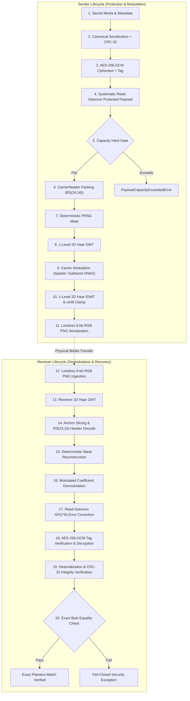
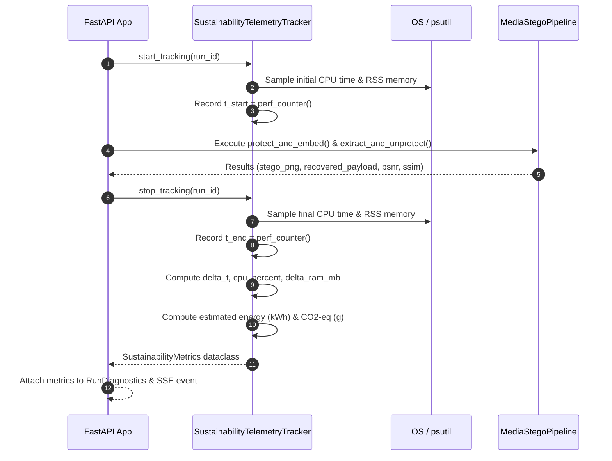

# PaladinMedia — Actual Data Flow Specification

**Document Version:** 3.0.0  
**Date:** 2026-11-02  
**Classification:** Technical Data Flow Specification  
**Status:** APPROVED FOR IMPLEMENTATION

---

## 1. End-to-End Data Flow Overview

This document specifies the exact stage-by-stage byte, tensor, and coefficient transformations across the entire PaladinMedia steganography lifecycle.



---

## 2. Stage-by-Stage Data Transformation Details

### Stage 1: Secret Media Ingestion & Structure
- **Input:** Raw secret file bytes (image, document, or binary payload).
- **Data Object:** `SecretPayload` dataclass:
  ```python
  SecretPayload(
      data: bytes,               # Raw binary payload
      media_type: MediaType,     # Enum (IMAGE, AUDIO, TEXT, BINARY)
      metadata: Dict[str, Any]   # Optional JSON-serializable dictionary
  )
  ```
- **Byte Boundary:** Must not exceed usable carrier capacity calculated at preflight.

### Stage 2: Canonical Serialization & CRC-32 Checksum
- **Transformation:** `SecretSerializer.serialize(secret_payload)`
- **Binary Wire Layout:**
  ```text
  +-------------------+--------------------+-------------------+--------------------+
  | Magic (4 bytes)   | Version (1 byte)   | Media Type (1B)   | Metadata Len (2B)  |
  | 0x50 0x4D 0x53 0x50 | 0x01             | (0x01 = IMAGE)    | uint16 big-endian  |
  +-------------------+--------------------+-------------------+--------------------+
  | Metadata (UTF-8 JSON bytes, N bytes)                                            |
  +-------------------+--------------------+-------------------+--------------------+
  | Payload Len (4B)  | Payload Data (M bytes)                                      |
  | uint32 big-endian | raw bytes                                                  |
  +-------------------+--------------------+-------------------+--------------------+
  | CRC-32 (4 bytes, IEEE 802.3 over preceding bytes)                               |
  +---------------------------------------------------------------------------------+
  ```
- **Output:** Serialized byte stream of length $S = 12 + N + M$ bytes.

### Stage 3: Authenticated Encryption (AES-256-GCM)
- **Transformation:** `AESGCMProvider.encrypt(plaintext, key, aad=None)`
- **Key:** 256-bit cryptographic key (32 bytes).
- **Nonce/IV:** 96-bit (12 bytes) cryptographically random nonce generated via OS CSPRNG (`secrets.token_bytes(12)`).
- **Authentication Tag:** 128-bit (16 bytes) GHASH authentication tag.
- **Output:** Single contiguous byte array:
  $$\text{Ciphertext Stream} = \text{Nonce (12B)} \mathbin{\Vert} \text{Ciphertext (S bytes)} \mathbin{\Vert} \text{Tag (16B)}$$
  Total encrypted length $E = S + 28$ bytes.

### Stage 4: Systematic Reed-Solomon Encoding over $\text{GF}(2^8)$
- **Transformation:** `ReedSolomonEncoder.encode(encrypted_bytes)`
- **Field Representation:** $\text{GF}(2^8)$ with irreducible polynomial $p(x) = x^8 + x^4 + x^3 + x^2 + 1$ (0x11D).
- **Profile:** RS(255, 207) with $2t = 48$ parity symbols per block (or RS(255, 223) with $2t = 32$).
- **Chunking:** Message is divided into data chunks of size $k = 255 - 2t = 207$ bytes. Each block is appended with $2t = 48$ parity bytes.
- **Interleaving (Wire Protocol v3):** Deterministic block-symbol interleaving disperses contiguous burst channel errors across independent RS codewords.
- **Output:** Protected payload of length $P = \lceil E / k \rceil \times 255$ bytes (last block shortened or zero-padded systematically).

### Stage 5: Capacity Analysis & Hard Gate
- **Validation:**
  $$P \le C_{\text{usable}} = \left\lfloor \frac{H \cdot W}{32} \right\rfloor - \text{HeaderBytes}$$
  where $H \times W$ are carrier pixel dimensions, and $\text{HeaderBytes} = 24$ (Wire Protocol v2/v3).
- **Hard Gate Action:** If $P > C_{\text{usable}}$, raises `PayloadCapacityExceededError` and aborts immediately without altering carrier or executing inference.

### Stage 6: Wire Framing & Carrier Header Packing
- **Transformation:** `CarrierHeader.create(session_counter, payload_length, ecc_parity, version=2).pack()`
- **V2/V3 Header Structure (24 bytes total):**
  - **16-byte Data Header:**
    - Magic: `0x50 0x4D 0x43 0x48` (`PMCH`)
    - Version: `0x02`
    - Flags: `0x01` (indicates RS 2t=48)
    - Session Counter: `uint32` (4 bytes big-endian)
    - Payload Length: `uint32` (4 bytes big-endian)
    - CRC-16: `uint16` (2 bytes checksum over first 14 bytes)
  - **8-byte Parity:** Shortened $\text{RS}(24, 16)$ parity computed over the 16 data bytes.
- **Output:** 24 bytes (192 bits) of protected header.

### Stage 7: Deterministic Mask Placement Generation
- **Transformation:** `DeterministicMaskGenerator.generate_mask(session_counter, payload_length, subband_dim)`
- **Algorithm:**
  - Seeds cryptographic PRNG with `HMAC-SHA256(key, "PaladinMedia_Mask_v2" || session_counter)`.
  - Header anchors: 192 fixed coordinates in low-frequency subband perimeter (relocated in v3 to avoid boundary clipping).
  - Payload coordinates: Permutation of remaining subband positions sampled deterministically without collision.
- **Output:** `EmbeddingMask` object containing ordered list of $(r, c)$ subband coordinate pairs.

### Stage 8 & 9: Discrete Wavelet Transform & Modulation Execution
- **Cover Ingestion:** Lossless 8-bit RGB array of shape $(H, W, 3)$.
- **Haar 2D DWT:** Decomposes carrier into four subbands per color channel:
  $$\text{LL} = \frac{a + b + c + d}{2}, \quad \text{LH} = \frac{-a - b + c + d}{2}$$
  $$\text{HL} = \frac{-a + b - c + d}{2}, \quad \text{HH} = \frac{a - b - c + d}{2}$$
- **Modulation Execution Paths:**
  1. **Spatial ONNX Path (`neural_spatial_embedding_opset14.onnx`):**
     - Inputs: Carrier RGB tensor $(1, 3, H, W)$, Mask $(1, 1, H/2, W/2)$, Bipolar Payload $(1, 1, H/2, W/2) \in \{-1.0, +1.0\}$.
     - Internal Graph: Computes internal Haar DWT; extracts Red-HH target and Green/Blue-HH context; predicts spatial context via convolutional blocks; scales bipolar symbols by adaptive gain $\gamma \ge 1.0$; applies internal Haar IDWT and clamps to $[0.0, 255.0]$.
  2. **Subband ONNX Path (`acs_sub_inn_embedding_opset14.onnx`):**
     - Inputs: External Red-HH `hh_drop` $(1, 1, H/2, W/2)$, Green/Blue-HH context `hh_keep` $(1, 2, H/2, W/2)$, Mask $(1, 1, H/2, W/2)$, Bipolar Payload $(1, 1, H/2, W/2)$.
     - Graph: Modulates Red-HH coefficients:
       $$\text{HH}_{\text{stego}} = (1 - M) \cdot \text{HH}_{\text{orig}} + M \cdot \left(\text{Context}(\text{HH}_{\text{keep}}) + \gamma \cdot S_{\text{bipolar}}\right)$$
     - External IDWT: Combines modulated Red-HH with original LL, LH, HL, and Green/Blue-HH to reconstruct spatial RGB.

### Stage 10 & 11: Spatial Synthesis & PNG Serialization
- **Quantization:** Reconstructed floating-point spatial values are rounded and clamped:
  $$\text{StegoPixel} = \min(255, \max(0, \text{round}(\text{SpatialRaw})))$$
- **Fidelity Calculation:** Computes PSNR and SSIM against original cover image.
- **Serialization:** Saves to lossless 8-bit Truecolor RGB PNG byte buffer (color type 2, bit depth 8).

---

## 3. Demodulation, Error Correction, and Verification Flow

### Stage 12 to 14: PNG Ingestion & Header Recovery
- **Ingestion:** Validates raw PNG magic signature and IHDR chunk. Rejects lossy carriers.
- **Transform:** Computes 1-level 2D Haar DWT to obtain received subbands.
- **Header Extraction:**
  - Slices received coefficients at the 192 fixed header anchor positions.
  - Demodulates binary bits ($+1$ if $\Delta > 0$, else $0$).
  - Assembles 24 bytes (192 bits).
  - Evaluates shortened $\text{RS}(24, 16)$ decoding. Corrects up to $t=4$ corrupted header bytes.
  - Verifies CRC-16 checksum. If invalid, extraction fails closed with `CarrierHeaderError`.

### Stage 15 & 16: Mask Reconstruction & Payload Demodulation
- **Mask Reconstruction:** Re-seeds PRNG with session counter from decoded header to generate identical payload coordinates.
- **Bit Slicing:** Extracts received coefficients at payload coordinates.
- **De-interleaving (v3):** Reverses block symbol interleaving to restore canonical Reed-Solomon block sequence.

### Stage 17: Reed-Solomon Error Correction
- **Syndrome Calculation:** Computes error syndromes $S_i$ over $\text{GF}(2^8)$ for each block.
- **Chien Search & Forney Algorithm:** Identifies error locations and error values.
- **Correction:** Corrects up to $t = 24$ corrupted bytes per 255-byte block.
- **Fail-Closed:** If uncorrectable errors exceed $t$, raises `ECCDecodeError`.

### Stage 18: AES-256-GCM Verification & Decryption
- **Integrity Tag Check:** Recomputes GHASH tag over ciphertext and AAD.
- **Fail-Closed Property:** If tag does not match in constant time, raises `AuthenticationError`. Tampered or clipped carriers cannot decrypt.
- **Decryption:** Decrypts ciphertext stream using AES-CTR mode.

### Stage 19 & 20: Deserialization & Exact Match Verification
- **CRC-32 Check:** Recomputes CRC-32 over deserialized fields. Verifies canonical framing.
- **Reconstruction:** Reconstructs original `SecretPayload` with metadata.
- **Byte Equality:** Compares recovered bytes against original payload:
  $$\text{exact\_match} = (\text{recovered\_bytes} == \text{original\_bytes})$$

---

## 4. Sustainability Telemetry Pipeline Flow



- **Power Model Equations:**
  $$\Delta t = t_{\text{end}} - t_{\text{start}} \quad [\text{seconds}]$$
  $$P_{\text{avg}} = P_{\text{idle}} + \left(\frac{\text{CPU}\%}{100}\right) \cdot (P_{\text{TDP}} - P_{\text{idle}}) + P_{\text{RAM}} \cdot \text{RAM}_{\text{GB}} \quad [\text{Watts}]$$
  $$\text{Energy} = P_{\text{avg}} \cdot \frac{\Delta t}{3600 \cdot 1000} \quad [\text{kWh}]$$
  $$\text{Emissions} = \text{Energy} \cdot 475.0 \quad [\text{g CO}_2\text{-eq}]$$
- **Transparency Flags:**
  `is_estimated = True`, `telemetry_source = "estimated_hardware_model"`.
