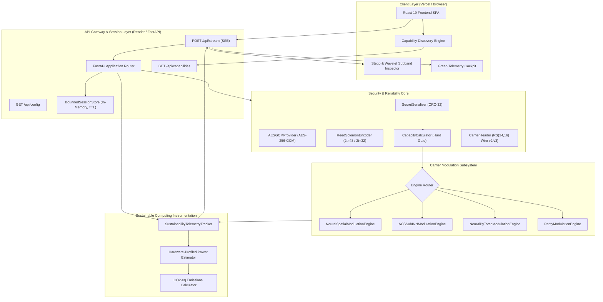
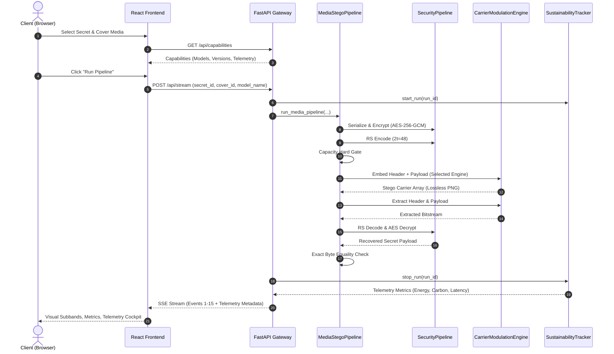
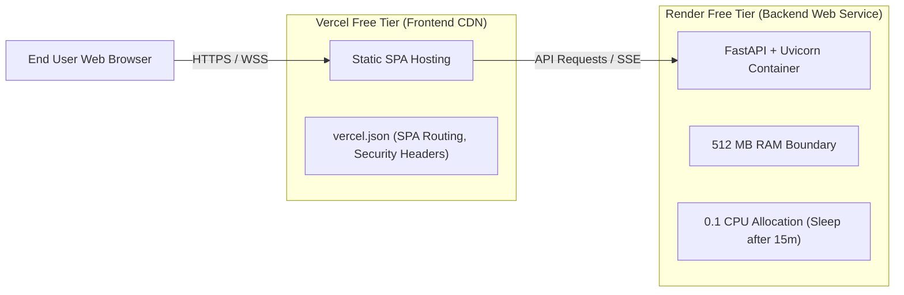

# PaladinMedia — Updated System Architecture

**Document Version:** 3.0.0  
**Date:** 2026-11-02  
**Classification:** Technical Architecture Specification  
**Status:** APPROVED FOR IMPLEMENTATION

---

## 1. System Overview

PaladinMedia is a post-quantum, energy-aware media steganography platform designed for secure, tamper-evident data hiding in uncompressed RGB digital imagery.

The architecture integrates six core subsystems:
1. **Frontend Presentation & Telemetry UI:** Modern React 19 single-page application built with TypeScript and Vite.
2. **Operational API & Session Router:** High-performance asynchronous FastAPI service enforcing security headers, request throttling, payload validation, and server-sent events (SSE).
3. **Cryptographic & Error Correction Core:** Unidirectional, fail-closed security pipeline integrating canonical serialization, AES-256-GCM authenticated encryption, and systematic Reed-Solomon coding over $\text{GF}(2^8)$.
4. **Transform-Domain Carrier Modulation Hierarchy:** Multi-backend engine abstraction supporting:
   - Qualified End-to-End Spatial ONNX (`neural_spatial_embedding_opset14.onnx`)
   - Transform-Domain Subband ACS-Sub-INN ONNX (`acs_sub_inn_embedding_opset14.onnx`)
   - PyTorch Neural Wavelet Reference (`ACSSubINN` + `NeuralSpatialBridge`)
   - Classical Integer Parity Fallback (`ParityModulationEngine`)
5. **Discrete Wavelet Transform (DWT) Core:** 1-level 2D Haar wavelet decomposition and inverse reconstruction.
6. **Sustainable Computing Telemetry Engine:** Dual-mode environmental accounting supporting direct CodeCarbon hardware tracking or transparent hardware-profiled power modeling.

---

## 2. High-Level Architectural Model



---

## 3. Subsystem Specifications

### 3.1 Frontend Presentation Subsystem
- **Framework:** React 19.0.0, TypeScript 5.7, Tailwind CSS, Vite 6.0.
- **Dynamic Capabilities Discovery:** On mount, queries `GET /api/capabilities` to determine:
  - Supported modulation engines (`neural_spatial_onnx`, `acs_sub_inn_onnx`, `acs_sub_inn_pytorch`, `parity_classical`).
  - Active default engine and ONNX artifact verification status.
  - Active wire protocol versions (v2, v3) and ECC profiles (`rs_2t_48`, `rs_2t_32`).
  - Maximum upload dimensions, size bounds, and telemetry engine state.
- **Dynamic UI State:**
  - Header reflects real backend model name, protocol version, and deployment status.
  - Model Selector dropdown enables runtime engine toggling.
  - Timeline stages dynamically update descriptions based on the active modulation engine.
  - Telemetry cockpit displays latency, CPU usage, memory delta, estimated energy ($kWh$), and $\text{CO}_2$ emissions ($g$).

### 3.2 API & Session Layer
- **Framework:** FastAPI, Starlette, Uvicorn, Python 3.11+.
- **Endpoints:**
  - `GET /api/health`: Health and readiness probe.
  - `GET /api/capabilities`: Complete system capabilities and available engines.
  - `GET /api/config`: Carrier capacity rules and operational facts.
  - `GET /api/carrier/capacity`: Dynamic capacity calculation for custom carrier dimensions.
  - `POST /api/upload`: Chunked, size-capped media upload returning session IDs with TTL.
  - `POST /api/stream`: Asynchronous Server-Sent Events (SSE) streaming of all 15 pipeline stages.
  - `POST /api/embed`: Direct synchronous embedding endpoint.
  - `POST /api/extract`: Direct synchronous extraction endpoint.
  - `GET /api/telemetry/{run_id}`: Dedicated telemetry query endpoint.
- **Security Invariants:**
  - Strict bounded upload limits (`MAX_UPLOAD_BYTES = 10 MB`).
  - Carrier dimension constraints: even dimensions, $32 \times 32 \le H \times W \le 2048 \times 2048$, $\le 4 \text{ Mpx}$.
  - Lossless PNG policy: non-PNG or lossy carriers (JPEG, WebP) are rejected with HTTP 422 before memory allocation.

### 3.3 Security & Cryptographic Core
- **Serialization:** Canonical byte-level framing with 32-bit CRC-32 integrity tag.
- **Authenticated Encryption:** AES-256-GCM with 96-bit unique nonce and 128-bit authentication tag. Operates strictly fail-closed: any tampered ciphertext or corrupted bit causes immediate rejection.
- **Error Correction Coding:** Systematic Reed-Solomon over $\text{GF}(2^8)$ using field generator polynomial $p(x) = x^8 + x^4 + x^3 + x^2 + 1$ (primitive 0x11D). Primary deployment profile uses $2t = 48$ parity symbols per 255-byte block.
- **Wire Protocol v2/v3 Framing:** 16-byte carrier header protected by shortened Reed-Solomon $\text{RS}(24, 16)$ with 8 parity bytes. Enables header recovery even under local spatial clipping or boundary coefficient noise.
- **Capacity Hard Gate:** Evaluates total bit requirement against available subband coefficients. Aborts with `PayloadCapacityExceededError` before modulation if payload exceeds allocated space.

### 3.4 Carrier Modulation Hierarchy
The `CarrierModulationEngine` base class defines a strict contract:
```python
class CarrierModulationEngine(ABC):
    @abstractmethod
    def embed_bits(self, cover_array: np.ndarray, header_bits: np.ndarray, payload_bits: np.ndarray, mask: EmbeddingMask) -> np.ndarray: ...

    @abstractmethod
    def begin_extraction(self, stego_array: np.ndarray, subband_dim: int) -> CarrierBitExtractor: ...
```

Four implementations provide runtime flexibility:
1. **`NeuralSpatialModulationEngine` (Production Default):**
   - Loads `neural_spatial_embedding_opset14.onnx` and `neural_spatial_extraction_opset14.onnx`.
   - Executes Haar DWT, ACS-Sub-INN context scaling, and Haar IDWT entirely inside the optimized ONNX runtime graph.
   - Ideal for low-latency, memory-constrained cloud environments (e.g., Render Free Tier).
2. **`ACSSubINNModulationEngine` (Transform Subband ONNX):**
   - Loads `acs_sub_inn_embedding_opset14.onnx` and `acs_sub_inn_extraction_opset14.onnx`.
   - Computes explicit 2D Haar DWT on cover RGB; passes Red-HH target and Green/Blue-HH context to the ONNX graph; reconstructs stego RGB via explicit 2D Haar IDWT.
   - Provides full transparency into coefficient-level manipulations.
3. **`NeuralPyTorchModulationEngine` (Research Reference):**
   - Executes PyTorch native `NeuralSpatialBridge` with Phase 4C checkpoint weights.
   - Supports gradient propagation and research diagnostics.
4. **`ParityModulationEngine` (Classical Baseline):**
   - Deterministic integer parity modulation ($2 \cdot HH \pmod 2 = \text{bit}$) on Red-HH.
   - Backward-compatible with Phase 2 verification.

### 3.5 Sustainable Computing Telemetry Engine
- **Telemetry Architecture:** Thread-safe, non-blocking telemetry tracker associating metrics with each `run_id`.
- **Sensing Modes:**
  1. **Direct Mode (CodeCarbon):** When `codecarbon` package is installed, uses `EmissionsTracker(save_to_file=False)` to record hardware energy and grid emissions.
  2. **Estimated Mode (Hardware-Profiled Model):** When `codecarbon` is absent (the current production environment), uses `psutil` and CPU specifications:
     - Measures elapsed wall-clock time $\Delta t$ ($ms$).
     - Samples process CPU utilization percentage and memory delta.
     - Estimates power consumption using standard thermal design power (TDP) modeling.
     - Calculates estimated $\text{CO}_2$ emissions based on regional grid carbon intensity ($475 \text{ g/kWh}$).
     - Explicitly flags all metrics: `is_estimated = True`, `telemetry_source = "estimated_hardware_model"`.

---

## 4. End-to-End Execution Sequence



---

## 5. Free-Tier Deployment Topology



### Constraints & Mitigations:
1. **512 MB RAM Boundary:** ONNX Runtime CPU session is configured with single-thread allocation (`intra_op_num_threads = 1`). In-memory image buffers are strictly scoped and garbage-collected immediately following pipeline completion.
2. **Cold Starts:** Free instances spin down after 15 minutes of inactivity. Frontend includes a polite cold-start indicator informing users when the backend is initializing.
3. **Lossless Media Transport:** Image payloads are serialized to PNG data URLs or fetched via streaming session references, preventing lossy transcoding.
