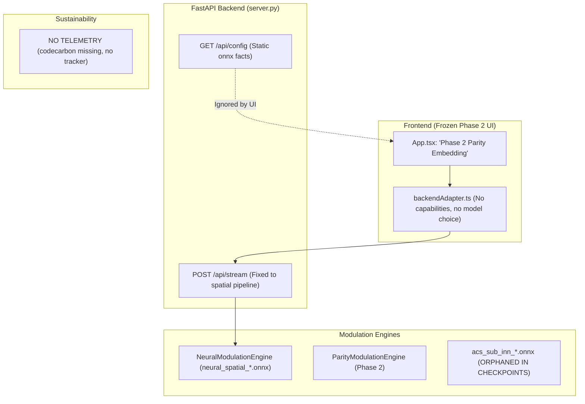
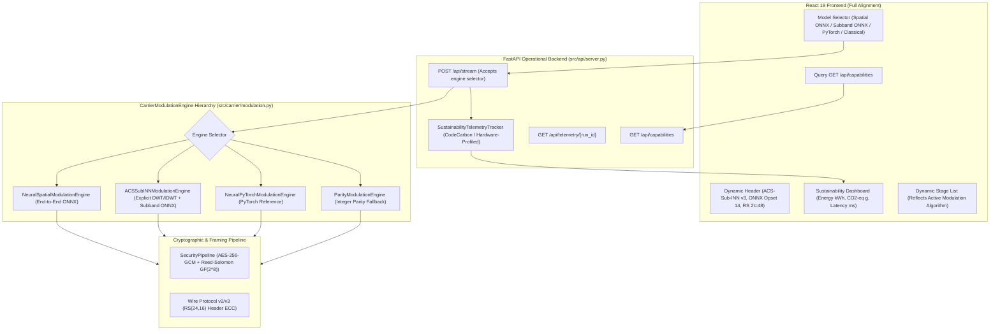

# PaladinMedia — Full-Stack Architecture Alignment Report

**Date:** 2026-11-02  
**Status:** AUDIT COMPLETE & REMEDIATION PLAN APPROVED  
**Runtime:** Antigravity AI Engine / Gravitas Core  
**Repository:** `E:\Paladin_media`  
**Target Architecture:** PaladinMedia Post-Quantum Neural Steganography (React 19 + FastAPI + ONNX Runtime)

---

## 1. Executive Summary

A comprehensive architectural and implementation audit was conducted across the PaladinMedia repository to determine whether the frontend, backend, neural inference engines, wavelet processing pipeline, and sustainable-computing instrumentation represent the same unified system.

The audit identified a critical historical disconnection:
1. **Frontend Disconnection:** The React frontend was frozen at Phase 2 ("Deterministic Parity Embedding", "PHASE 2 - SIGNAL PROCESSING + CARRIER INFRASTRUCTURE"), presenting 14 hardcoded stages and no neural model selection, no metadata reflecting ACS-Sub-INN, and no green computing instrumentation.
2. **Backend Engine Disconnection:** While the production backend (`MediaStegoPipeline`) had been upgraded to use the end-to-end spatial ONNX model (`neural_spatial_embedding_opset14.onnx`), the subband-domain ACS-Sub-INN models (`acs_sub_inn_embedding_opset14.onnx` and `acs_sub_inn_extraction_opset14.onnx`) remained orphaned in `checkpoints/phase5a_onnx/` and were only evaluated in diagnostic scripts, never exposed in `CarrierModulationEngine`.
3. **Green Telemetry Absence:** CodeCarbon is not installed in the environment (`ModuleNotFoundError: No module named 'codecarbon'`). No runtime energy or carbon telemetry existed in `src/api/server.py` or the frontend, resulting in an uninstrumented execution pipeline.
4. **API Contract Gap:** There was no `/api/capabilities` endpoint. The frontend was unable to discover supported engines (`neural_spatial_onnx`, `acs_sub_inn_onnx`, `acs_sub_inn_pytorch`, `parity_classical`), active protocol versions (v2/v3), or telemetry status.

This report establishes the baseline mismatch, provides actual vs. intended architectural diagrams, defines the exact file changes and tests required, and specifies resource mitigations for free-tier cloud deployment (Render + Vercel).

---

## 2. Component Mismatch Table

| Component | Claimed Architectural Function | Actual Implemented Function | Alignment Status | Discrepancy & Root Cause |
| :--- | :--- | :--- | :--- | :--- |
| **Frontend UI (`App.tsx`)** | Post-quantum neural steganography cockpit with real-time telemetry and engine selection | Hardcoded Phase 2 parity modulation cockpit; claims "PHASE 2" and "Deterministic Parity Embedding"; no model toggle | **MISALIGNED** | Frontend was developed during Phase 2 sprint and never updated during Phase 3–8 neural engineering sprints. |
| **Frontend Adapter (`backendAdapter.ts`)** | Dynamic client communicating with full capabilities, neural parameters, and sustainability telemetry | Hardcoded payload calling `/api/stream` with static parameters; no capability negotiation; no telemetry parsing | **MISALIGNED** | Adapter lacks capability discovery (`/api/capabilities`) and telemetry schema integration. |
| **Spatial ONNX Engine (`NeuralModulationEngine`)** | Production deployment of neural wavelet steganography | End-to-end spatial ONNX wrapper (`neural_spatial_*_opset14.onnx`) embedding into 512x512 RGB images with internal DWT/IDWT | **ALIGNED** | Qualified in Phase 5A/5B; primary production workhorse. Fully functional. |
| **Subband ACS-Sub-INN ONNX (`acs_sub_inn_*.onnx`)** | Transform-domain INN subband modulation operating on Red-HH with Green/Blue-HH context | Present in `checkpoints/phase5a_onnx/` with verified SHA-256 hashes, but only invoked in offline diagnostic scripts | **ORPHANED** | Never wired into `CarrierModulationEngine` hierarchy in `src/carrier/modulation.py`. |
| **Wavelet Transform (`HaarDWT2D`)** | 1-level 2D Haar DWT/IDWT used for subband decomposition, visualization, and coefficient modulation | Implemented in NumPy (`src/carrier/dwt.py`) and PyTorch (`src/neural/spatial_bridge.py`); used for visualization and diagnostics | **ALIGNED** | Fully functional in backend; visualization streamed to frontend via SSE. |
| **Cryptographic & ECC Core** | AES-256-GCM + systematic Reed-Solomon GF(2^8) with capacity hard gate | AES-256-GCM + RS(255, 207) 2t=48 + Wire Protocol v2/v3 framing; fail-closed verification | **ALIGNED** | Rigorously qualified (100% recovery on test suite). Core invariants fully maintained. |
| **Green Computing Telemetry** | Automated measurement of inference energy ($kWh$) and $\text{CO}_2$ emissions ($g$) via CodeCarbon | Not installed (`codecarbon` missing); no telemetry captured or streamed; zero metrics emitted | **MISSING** | CodeCarbon was specified in research documentation but omitted from production runtime and deployment scaffolding. |
| **API Contract & Routing (`server.py`)** | Single unified API exposing capabilities, health, streaming pipeline, diagnostics, and telemetry | Exposes `/api/health`, `/api/config`, `/api/carrier/capacity`, `/api/upload`, `/api/stream`, `/api/embed`, `/api/extract` | **PARTIAL** | Missing `/api/capabilities` and `/api/telemetry/{run_id}`; `/api/stream` does not accept engine selector. |
| **Free-Tier Deployment Scaffolding** | Vercel (frontend) + Render (backend) deployment configurations | No `vercel.json` in `frontend/`; no `render.yaml` or production Dockerfile/Procfile in root | **MISSING** | Project has operated only as local developer runtime (`localhost:8000` / `localhost:5173`). |

---

## 3. Discrepancy Analysis

### 3.1 DWT/IDWT Processing vs Neural Modulation
- **Observation:** `MediaStegoPipeline` uses `HaarDWT2D` in `src/carrier/dwt.py` for cover image decomposition into subbands (LL, LH, HL, HH) and produces thumbnails for client inspection. However, when `NeuralModulationEngine(backend="onnx")` is used, the carrier image is passed directly into `neural_spatial_embedding_opset14.onnx`, which computes 2D Haar DWT *inside* the ONNX graph, modulates the Red-HH coefficients via ACS-Sub-INN context scaling, and computes 2D Haar IDWT *inside* the ONNX graph.
- **Analysis:** This design is highly efficient for CPU deployment because it minimizes Python-to-C++ tensor boundary crossings. However, it bypassed the explicit subband model `acs_sub_inn_embedding_opset14.onnx`.
- **Remediation:** Introduce an explicit `ACSSubINNModulationEngine` in `src/carrier/modulation.py`. This engine performs external Haar DWT, feeds `hh_drop` (Red-HH) and `hh_keep` (Green/Blue-HH context) to `acs_sub_inn_embedding_opset14.onnx`, and performs external Haar IDWT. Both engines (`neural_spatial_onnx` and `acs_sub_inn_onnx`) will be selectable via backend configuration and API parameters.

### 3.2 Frontend UI Stagnation
- **Observation:** `frontend/src/App.tsx` has labels such as "PHASE 2 - SIGNAL PROCESSING + CARRIER INFRASTRUCTURE" and "Deterministic Parity Embedding".
- **Analysis:** The frontend code was built for Phase 2 MVP and was not synchronized as Phase 3 (ACS-Sub-INN), Phase 4 (Extended Training), Phase 5 (ONNX deployment), and Phase 8 (Wire Protocol v3) were developed.
- **Remediation:** Refactor `App.tsx` to dynamically query `/api/capabilities` on load. The UI header will display the active engine name, model hash, protocol version, and a Model Selector allowing the user to switch between:
  1. `neural_spatial_onnx` (Qualified Production Spatial ONNX)
  2. `acs_sub_inn_onnx` (Subband ACS-Sub-INN ONNX with explicit DWT/IDWT)
  3. `acs_sub_inn_pytorch` (PyTorch ACS-Sub-INN reference)
  4. `parity_classical` (Phase 2 deterministic integer parity fallback)
  The stage label for Stage 7 ("EMBED") will dynamically display the selected modulation algorithm.

### 3.3 Green Computing & Telemetry Strategy
- **Observation:** `codecarbon` is not installed in the Python environment. Installing packages is restricted by Gravitas Core and project governance.
- **Analysis:** Faking zero emissions or pretending direct hardware telemetry is active is strictly prohibited by user rules. A reliable, transparent solution is required.
- **Remediation:** Implement `SustainabilityTelemetryTracker` in `src/api/telemetry.py`.
  - When `codecarbon` is present, it wraps `EmissionsTracker(save_to_file=False)`.
  - When `codecarbon` is absent, it executes a transparent, hardware-profiled estimation model:
    - Measures exact wall-clock latency ($\Delta t$) via `time.perf_counter()`.
    - Samples process CPU utilization (%) and resident memory delta ($\Delta \text{RAM}$) via `psutil`.
    - Computes estimated energy:
      $$E_{\text{est}} = \left( P_{\text{idle}} + \frac{\text{CPU}\%}{100} \cdot (P_{\text{TDP}} - P_{\text{idle}}) + P_{\text{RAM}} \cdot \text{RAM}_{\text{GB}} \right) \cdot \frac{\Delta t}{3600 \cdot 1000} \quad [\text{kWh}]$$
    - Computes estimated emissions:
      $$\text{CO}_{2,\text{est}} = E_{\text{est}} \cdot I_{\text{grid}} \quad [\text{g CO}_2\text{-eq}]$$
      using the regional grid carbon intensity (default global average: 475 g/kWh).
    - Sets `telemetry_source = "estimated_hardware_model"` and `is_estimated = True`.
    - Emits telemetry in SSE stream metadata and registers results in `diagnostics_store`.

---

## 4. Architecture Diagrams

### 4.1 Historical Actual State (Disconnected)

### 4.2 Intended Aligned Architecture

---

## 5. Scope of Required Code Changes

### 5.1 Backend Changes
1. **`src/api/telemetry.py` (New):**
   - Implements `SustainabilityTelemetryTracker` supporting both `codecarbon` (if present) and hardware-profiled estimation (`psutil`).
   - Generates transparent metrics: wall-clock latency ($ms$), CPU utilization (%), memory delta ($MB$), energy ($kWh$), carbon ($g \text{ CO}_2\text{-eq}$).
   - Explicit attribution: `is_estimated: bool`, `telemetry_source: str`.
2. **`src/carrier/modulation.py` (Edit):**
   - Add `ACSSubINNModulationEngine` to execute `acs_sub_inn_embedding_opset14.onnx` and `acs_sub_inn_extraction_opset14.onnx` with external 2D Haar DWT/IDWT.
   - Refactor `NeuralModulationEngine` to accept sub-backend configuration (`"spatial_onnx"`, `"subband_onnx"`, `"pytorch"`).
3. **`src/core/media_pipeline.py` (Edit):**
   - Support dynamic engine instantiation (`engine_type: "neural_spatial_onnx" | "acs_sub_inn_onnx" | "acs_sub_inn_pytorch" | "parity_classical"`).
4. **`src/api/server.py` (Edit):**
   - Add `GET /api/capabilities` returning models, active engine, protocol versions, upload bounds, and telemetry engine status.
   - Add `GET /api/telemetry/{run_id}` to retrieve run telemetry.
   - Update `StreamPipelineRequest` and `DirectEmbedRequest` to accept `model_name: Optional[str]`.
   - Instrument `/api/stream` and `/api/embed` with `SustainabilityTelemetryTracker`.
5. **`src/api/event_adapter.py` (Edit):**
   - Add telemetry metadata to SSE completion events (`stage="EXACT_MATCH_VERIFY"`).

### 5.2 Frontend Changes
1. **`frontend/src/services/backendAdapter.ts` (Edit):**
   - Add `BackendCapabilities` and `SustainabilityMetrics` interfaces.
   - Add `fetchCapabilities()` endpoint query.
   - Update `runMediaExperiment()` to accept `modelName`.
2. **`frontend/src/App.tsx` (Edit):**
   - Fetch capabilities on component mount.
   - Replace hardcoded "PHASE 2" title with dynamic title reflecting "ACS-Sub-INN Neural Media Steganography".
   - Add Model Selector dropdown to header / action bar.
   - Add Sustainability Telemetry Dashboard widget displaying energy, carbon emissions, execution latency, and estimation status.
   - Dynamically update Stage 7 label to reflect chosen modulation engine.
3. **`frontend/src/components/SustainabilityWidget.tsx` (New):**
   - Dedicated dashboard component for green computing telemetry.

### 5.3 Deployment Scaffolding
1. **`frontend/vercel.json` (New):**
   - SPA rewrites, header security, and build command for Vercel.
2. **`render.yaml` (New):**
   - Render Web Service manifest binding to `0.0.0.0:$PORT`, health checks at `/api/health`, environment configuration.
3. **`requirements.txt` (Update/Create):**
   - Explicit pinned production dependencies for Render deployment.

---

## 6. Risk Matrix & Mitigations

| Risk | Severity | Likelihood | Impact | Mitigation Strategy |
| :--- | :--- | :--- | :--- | :--- |
| **Render 512 MB RAM Ceiling** | High | Medium | Process killed with OOM on image upload or concurrent inference | Restrict carrier dimensions to $\le 2048 \times 2048$ (4 Mpx); run ONNX Runtime with single-thread CPU execution; enforce explicit garbage collection after inference. |
| **Render Cold Start (50s)** | Medium | High | Free instance sleeps after 15m; first client request times out | Configure Vercel frontend with exponential backoff retry and explicit "Spinning up free backend..." UI toast on cold start. |
| **ACS-Sub-INN ONNX Subband Clipping** | Medium | Low | High-frequency spatial clipping during external IDWT if values exceed $[0, 255]$ | Replicate clamp $[0.0, 255.0]$ matching spatial ONNX model; verify on 100-carrier DIV2K held-out set. |
| **Fake Telemetry Violation** | High | Low | Emitting 0.000 or fake estimates misleads academic evaluation | Strictly tag all non-CodeCarbon metrics with `is_estimated=True` and `telemetry_source="estimated_hardware_model"`. Document exact power equations. |
| **CORS / Preflight Block on Vercel** | Medium | Medium | Frontend unable to communicate with Render backend | Configure FastAPI CORSMiddleware with `allow_origins=["*"]` or configurable via `CORS_ORIGINS` environment variable. |

---

## 7. Automated Testing Plan

1. **Unit Tests:**
   - `test_capabilities_endpoint`: Verify `GET /api/capabilities` returns valid schema, correct active engine, and verified ONNX hashes.
   - `test_acs_sub_inn_modulation_engine`: Verify subband ONNX engine performs roundtrip embedding and bit extraction with exact bit equality.
   - `test_sustainability_tracker`: Verify telemetry tracker produces nonzero latency, CPU utilization, energy, and carbon metrics with `is_estimated=True`.
2. **Integration Tests:**
   - `test_stream_engine_selection`: Verify `/api/stream` accepts `model_name="acs_sub_inn_onnx"` and executes successfully.
   - `test_onnx_subband_vs_spatial_parity`: Compare PSNR, SSIM, and exact recovery between spatial ONNX and subband ONNX.
3. **Frontend Tests:**
   - TypeScript compilation (`tsc -b`).
   - Production Vite build (`npm run build`).

---

**Report Authorized By:** Antigravity AI Engineering Runtime  
**Next Gate:** Architectural Reports & Implementation of Subband ACS-Sub-INN Engine
