# PaladinMedia Phase 3 — Sprint 1.1: Extraction Contract Audit and Sprint 2 Readiness Report

**Document ID:** `PDM-AUDIT-P3-SPRINT1-1-EXTRACTION-20261018`
**Date:** 2026-10-18
**Repository:** `E:\Paladin_media`
**Status:** AUDITED & PASSING
**Governing Documents:**
- PaladinMedia Architecture Specification §10–§15
- Phase 3 Acceptance Criteria ([`docs/specifications/Phase3_Acceptance_Criteria.md`](file:///e:/Paladin_media/docs/specifications/Phase3_Acceptance_Criteria.md))
- Phase 3 Sprint 1 Report ([`docs/audits/PHASE3_SPRINT1_NEURAL_CORE_REPORT.md`](file:///e:/Paladin_media/docs/audits/PHASE3_SPRINT1_NEURAL_CORE_REPORT.md))
- Sprint 1.1 Extraction Test Suite ([`tests/unit/test_neural_extraction.py`](file:///e:/Paladin_media/tests/unit/test_neural_extraction.py))

---

## 1. Executive Summary

This audit report documents the formal verification and boundary analysis of the **coefficient-domain extraction contract** for the ACS-Sub-INN v3 neural architecture ([`src/neural/acs_sub_inn.py`](file:///e:/Paladin_media/src/neural/acs_sub_inn.py)) ahead of Sprint 2 (DWT/IDWT Neural Bridge).

### Key Audit Findings
1. **Mathematical Extraction Rule Verified:** The coefficient extraction implements the exact sign-demodulation rule:
   $$\hat{b} = (\Delta_{\text{rec}} > 0.0) \in \{0, 1\}$$
   where $\Delta_{\text{rec}} = \text{HH}_{\text{drop}}^* - \text{context}_{\text{rec}}$.
2. **Gain Positivity Floor Verified:** The modulation gain $\gamma(x, y)$ strictly enforces $\gamma(x, y) \ge \gamma_{\text{min}} > 0$ via the parametric activation $\gamma = \text{Softplus}(\text{raw\_gain}) + \gamma_{\text{min}}$. The analytical decision margin is proved to be strictly equal to $\gamma$.
3. **Comprehensive Unit Testing Completed:** A targeted 15-test unit suite ([`tests/unit/test_neural_extraction.py`](file:///e:/Paladin_media/tests/unit/test_neural_extraction.py)) was authored and executed. All 15 tests passed in 1.94s covering all-zero/all-one payloads, near-floor gains, unchanged-context exact recovery ($\text{BER} = 0.000000$), controlled context perturbations crossing the decision boundary, unmasked coefficient identity, and input validation.
4. **STE Connectivity Audited:** Straight-Through Estimators (`RoundSTE`, `SpatialQuantizeSTE`) in [`src/neural/quantization.py`](file:///e:/Paladin_media/src/neural/quantization.py) were audited and confirmed to be **standalone primitives not connected to any active training graph or pipeline**.
5. **Zero Phase 2 Regressions:** The full repository regression suite was executed: **142/142 tests passed** (103 legacy Phase 2 + 24 Sprint 1 + 15 Sprint 1.1). Zero modifications were made to Phase 2 source code, cryptographic primitives, framing, or datasets.
6. **Sprint 2 Readiness Approved:** Architectural requirements and known blockers (spatial rounding quantization, channel clipping, and non-linear context drift) for the DWT/IDWT neural bridge are documented with mitigation strategies.

---

## 2. Extraction Contract Mathematical Analysis

### 2.1 Forward Embedding Formulation
For carrier subbands partitioned under Subband Option A:
- $\text{HH}_{\text{drop}} \in \mathbb{R}^{B \times 1 \times H_{\text{sub}} \times W_{\text{sub}}}$: Target modulation subband (Red-HH).
- $\text{HH}_{\text{keep}} \in \mathbb{R}^{B \times 2 \times H_{\text{sub}} \times W_{\text{sub}}}$: Preserved context subbands (Green-HH and Blue-HH).
- $M \in [0.0, 1.0]^{B \times 1 \times H_{\text{sub}} \times W_{\text{sub}}}$: Spatial embedding mask.
- $b \in \{0, 1\}^{B \times 1 \times H_{\text{sub}} \times W_{\text{sub}}}$: Binary payload bits.

Binary bits are mapped to bipolar modulation symbols:
$$P = 2b - 1 \in \{-1.0, +1.0\}$$

The forward stego subband $\text{HH}_{\text{drop}}'$ is computed as:
$$\text{context} = f_{\theta}(\text{HH}_{\text{keep}})$$
$$\gamma = g_{\phi}(\text{HH}_{\text{keep}}) = \text{Softplus}(\tilde{g}_{\phi}(\text{HH}_{\text{keep}})) + \gamma_{\text{min}}$$
$$\text{HH}_{\text{drop}}' = (1 - M) \odot \text{HH}_{\text{drop}} + M \odot (\text{context} + \gamma \odot P)$$

### 2.2 Receiver Extraction Formulation
At the extraction receiver, given received subbands $\text{HH}_{\text{drop}}^*$ and $\text{HH}_{\text{keep}}^*$:
$$\text{context}_{\text{rec}} = f_{\theta}(\text{HH}_{\text{keep}}^*)$$
$$\Delta_{\text{rec}} = \text{HH}_{\text{drop}}^* - \text{context}_{\text{rec}}$$
$$\hat{b} = (\Delta_{\text{rec}} > 0.0) = \begin{cases} 1, & \Delta_{\text{rec}} > 0.0 \\ 0, & \Delta_{\text{rec}} \le 0.0 \end{cases}$$

### 2.3 Decision Margin and Perturbation Sensitivity
Let received coefficients include channel perturbation / quantization errors $\epsilon_{\text{drop}}$ and let context subbands suffer perturbation $\delta_{\text{keep}}$ inducing context prediction error $\delta_{\text{context}} = f_{\theta}(\text{HH}_{\text{keep}} + \delta_{\text{keep}}) - f_{\theta}(\text{HH}_{\text{keep}})$:
$$\text{HH}_{\text{drop}}^* = \text{context} + \gamma \cdot P + \epsilon_{\text{drop}}$$
$$\text{context}_{\text{rec}} = \text{context} + \delta_{\text{context}}$$
$$\Delta_{\text{rec}} = \gamma \cdot P + (\epsilon_{\text{drop}} - \delta_{\text{context}})$$

Defining total channel-induced extraction error as $e_{\text{total}} = \epsilon_{\text{drop}} - \delta_{\text{context}}$:
$$\Delta_{\text{rec}} = \gamma \cdot P + e_{\text{total}}$$

We evaluate the decision criteria for both payload symbols:

1. **Transmitted Bit $b = 1$ ($P = +1.0$):**
   $$\Delta_{\text{rec}} = \gamma + e_{\text{total}}$$
   Decoded bit is $\hat{b} = 1 \iff \Delta_{\text{rec}} > 0 \iff e_{\text{total}} > -\gamma$.
   *Decision margin:* The received symbol is correctly decoded as long as the opposing perturbation satisfies $|e_{\text{total}}| < \gamma$. A bit error occurs if and only if $e_{\text{total}} \le -\gamma$.

2. **Transmitted Bit $b = 0$ ($P = -1.0$):**
   $$\Delta_{\text{rec}} = -\gamma + e_{\text{total}}$$
   Decoded bit is $\hat{b} = 0 \iff \Delta_{\text{rec}} \le 0 \iff e_{\text{total}} \le \gamma$.
   *Decision margin:* The received symbol is correctly decoded as long as the opposing perturbation satisfies $e_{\text{total}} < \gamma$. A bit error occurs if and only if $e_{\text{total}} > \gamma$.

**Conclusion:** The symbol decision margin is strictly symmetric and equal to $\gamma(x, y)$. Because the adaptive gain network explicitly enforces $\gamma(x, y) \ge \gamma_{\text{min}} > 0$, the decision boundary has a guaranteed minimum margin against zero-mean channel noise of at least $\gamma_{\text{min}}$.

---

## 3. Targeted Test Suite Verification (`test_neural_extraction.py`)

A dedicated suite of 15 unit tests was implemented in [`tests/unit/test_neural_extraction.py`](file:///e:/Paladin_media/tests/unit/test_neural_extraction.py) to validate every operational edge case:

| Test Name | Test Focus | Status | Duration |
|:---|:---|:---:|:---:|
| `test_extraction_all_zeros_payload` | All-zero payload ($b=0 \implies P=-1.0 \implies \Delta_{\text{rec}} = -\gamma < 0$). | PASS | 0.08s |
| `test_extraction_all_ones_payload` | All-one payload ($b=1 \implies P=+1.0 \implies \Delta_{\text{rec}} = +\gamma > 0$). | PASS | 0.08s |
| `test_extraction_near_positive_floor[0.1]` | Positive gain floor $\gamma_{\text{min}} = 0.1$ under saturated negative raw logits. | PASS | 0.05s |
| `test_extraction_near_positive_floor[0.5]` | Positive gain floor $\gamma_{\text{min}} = 0.5$ under saturated negative raw logits. | PASS | 0.05s |
| `test_extraction_near_positive_floor[1.0]` | Positive gain floor $\gamma_{\text{min}} = 1.0$ under saturated negative raw logits. | PASS | 0.05s |
| `test_extraction_near_positive_floor[2.0]` | Positive gain floor $\gamma_{\text{min}} = 2.0$ under saturated negative raw logits. | PASS | 0.05s |
| `test_exact_recovery_with_unchanged_context[101-1]` | Exact recovery under invariant context (Seed 101, Batch 1). $\text{BER} = 0.000000$. | PASS | 0.08s |
| `test_exact_recovery_with_unchanged_context[101-4]` | Exact recovery under invariant context (Seed 101, Batch 4). $\text{BER} = 0.000000$. | PASS | 0.09s |
| `test_exact_recovery_with_unchanged_context[202-1]` | Exact recovery under invariant context (Seed 202, Batch 1). $\text{BER} = 0.000000$. | PASS | 0.08s |
| `test_exact_recovery_with_unchanged_context[202-4]` | Exact recovery under invariant context (Seed 202, Batch 4). $\text{BER} = 0.000000$. | PASS | 0.08s |
| `test_exact_recovery_with_unchanged_context[303-1]` | Exact recovery under invariant context (Seed 303, Batch 1). $\text{BER} = 0.000000$. | PASS | 0.08s |
| `test_exact_recovery_with_unchanged_context[303-4]` | Exact recovery under invariant context (Seed 303, Batch 4). $\text{BER} = 0.000000$. | PASS | 0.09s |
| `test_controlled_context_perturbation_margin_crossing` | Decision boundary crossing: sub-margin ($0.5\gamma$) vs super-margin ($1.5\gamma$). | PASS | 0.05s |
| `test_unmasked_coefficients_strictly_unchanged` | Checkerboard mask: unmasked coefficients have absolute diff $= 0.000000$. | PASS | 0.06s |
| `test_mask_and_payload_shape_and_range_validation` | Comprehensive rejection of 3D masks, dimension mismatch, out-of-range $[0, 1]$, and wrong channels. | PASS | 0.06s |

**Total Execution Time:** 1.94s. All 15 tests passed with zero errors or warnings.

---

## 4. STE Training Graph Connectivity Audit

An explicit code audit was performed to determine whether the Straight-Through Estimators implemented in [`src/neural/quantization.py`](file:///e:/Paladin_media/src/neural/quantization.py) are connected to any training or execution graph.

### 4.1 Modules Inspected
- `RoundSTE` (`torch.autograd.Function`)
- `SpatialQuantizeSTE` (`nn.Module`)
- Functional wrappers: `round_ste`, `spatial_quantize_ste`

### 4.2 Codebase Search Results
A recursive symbol search across the entire repository revealed the following import and call sites:
1. Defined in [`src/neural/quantization.py`](file:///e:/Paladin_media/src/neural/quantization.py)
2. Exported in [`src/neural/__init__.py`](file:///e:/Paladin_media/src/neural/__init__.py)
3. Tested in [`tests/unit/test_neural_components.py`](file:///e:/Paladin_media/tests/unit/test_neural_components.py) (`test_round_ste_forward_and_backward`, `test_spatial_quantize_ste_forward_and_backward`)

### 4.3 Audit Finding
> [!IMPORTANT]
> **STE Modules are Unconnected Primitives:**
> The STE modules are completely isolated mathematical primitives. They are **not** referenced or imported by `ACSSubINN`, any carrier pipeline, loss function, optimizer, dataset loader, or training loop. There is currently no active training graph in the repository. We do not infer integration from their mere presence.
>
> They are staged cleanly for integration into the spatial bridge in Sprint 2 and the training loop in Sprint 3.

---

## 5. Architectural Boundary and Invariant Verification

| Invariant / Constraint | Verification Method | Status | Notes |
|:---|:---|:---:|:---|
| **Phase 2 Source Integrity** | `git diff src/carrier/ src/core/ src/security/` | PASSED | Zero modifications. Exact byte-level preservation. |
| **No Latent Variable Discarding** | Source inspection of `ACSSubINN.extract_coefficients` | PASSED | Pure context-subtraction inversion; no unrecoverable variables. |
| **No Secret-Side DWT** | Pipeline inspection | PASSED | Encrypted payload bits enter directly into bipolar symbol modulation. |
| **Demodulation Precision** | Unit testing on all-0, all-1, and random bit patterns | PASSED | Decision boundary operates at bit-exact precision ($BER = 0.0$). |
| **Fail-Closed Validation** | Input shape and range assertions in `ACSSubINN` | PASSED | Explicit exceptions raised on dimension, range, or channel errors. |
| **Repository Regression** | `pytest tests/` | PASSED | **142/142 tests passing** (100% pass rate). |

---

## 6. Sprint 2 (DWT/IDWT Neural Bridge) Readiness & Known Blockers

Sprint 2 will connect the spatial image domain to the coefficient domain via forward 2D Haar DWT and inverse 2D Haar IDWT transforms.

### 6.1 Proposed Dataflow for Sprint 2

```mermaid
flowchart LR
    RGB["Spatial Carrier (RGB uint8)"] --> DWT["2D Haar DWT (Differentiable)"]
    DWT --> Subbands["Split Subbands (LL, LH, HL, HH)"]
    Subbands --> SubbandPartition["Split HH: Red-HH (drop) & Green/Blue-HH (keep)"]
    SubbandPartition --> ACSEmbed["ACSSubINN Embed"]
    ACSEmbed --> SubbandMerge["Reassemble HH & LL, LH, HL"]
    SubbandMerge --> IDWT["2D Haar IDWT (Differentiable)"]
    IDWT --> Quantize["SpatialQuantizeSTE (Round & Clamp [0, 255])"]
    Quantize --> StegoRGB["Stego Image (Spatial RGB uint8)"]
```

### 6.2 Interface Requirements for Sprint 2
1. **Differentiable DWT/IDWT Bridge:** Must be implemented in PyTorch using 2D Haar wavelet decomposition (`torch.nn.functional.conv2d` and `conv_transpose2d` or custom orthogonal matrix filters) to support end-to-end backpropagation.
2. **Channel Format Consistency:** Must enforce BCHW tensor conventions with float values normalized to $[0.0, 255.0]$ or $[0.0, 1.0]$ matching Phase 2 baseline carrier dynamics.
3. **Subband Partitioning Alignment:** Must strictly match the Phase 2 channel and subband partition ($C_0 = \text{Red}$, $C_1 = \text{Green}$, $C_2 = \text{Blue}$; Subband $3 = \text{HH}$).

### 6.3 Known Blockers and Empirical Risks for Sprint 2
1. **Spatial Rounding Induced Error on Target Subband ($\epsilon_{\text{drop}}$):**
   - Converting float coefficients $\to$ spatial pixels $\to$ rounding to integer $[0, 255] \to$ forward DWT back to coefficients introduces spatial rounding noise.
   - For 2D Haar wavelets, rounding noise in spatial pixels produces subband perturbation $\epsilon_{\text{drop}} \in [-1.0, +1.0]$ on Red-HH.
   - *Risk:* If $\gamma < 1.0$, this rounding error alone could cross the decision boundary.
   - *Mitigation:* The default gain floor $\gamma_{\text{min}} = 1.0$ established in Sprint 1 provides baseline safety. Sprint 2 must empirically measure extraction BER under lossless PNG spatial rounding with $\gamma_{\text{min}} \in [1.0, 3.0]$.
2. **Dynamic Range Clipping Distortion:**
   - Spatial values outside $[0, 255]$ are clamped by `SpatialQuantizeSTE`. Clamping is non-linear and causes severe coefficient distortion in high-contrast saturated regions.
   - *Mitigation:* Ensure loss functions penalize out-of-range spatial pixel values and consider edge/saturation masking during embedding.
3. **Context Subband Perturbation ($\delta_{\text{context}}$):**
   - Spatial rounding also affects Green-HH and Blue-HH ($\text{HH}_{\text{keep}}$), which means $\text{HH}_{\text{keep}}^* \neq \text{HH}_{\text{keep}}$.
   - Since `ContextPredictorCNN` is a non-linear neural network, small perturbations in $\text{HH}_{\text{keep}}$ can be magnified into larger context prediction drift $\delta_{\text{context}}$.
   - *Mitigation:* In Sprint 2, quantify the context prediction error $\|\delta_{\text{context}}\|$ under spatial rounding and verify that $\|e_{\text{total}}\| = \|\epsilon_{\text{drop}} - \delta_{\text{context}}\| < \gamma$ across all carrier test images.

---

## 7. Sign-Off and Next Steps

- **Sprint 1.1 Status:** **PASSED & COMPLETE**.
- **Action:** Handoff to Sprint 2 implementation. Neural core extraction contracts are audited, mathematically proven, and covered by automated regression tests.
- **Governing Invariant:** No further edits to Phase 2 files. No training initiation until Sprint 2 bridge and Sprint 3 training scaffolding are complete.
