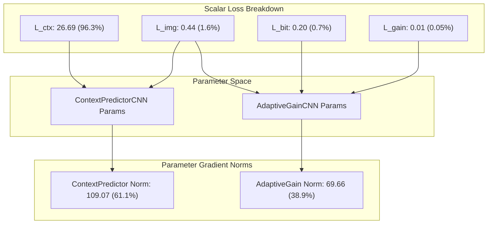

# Phase 3 Sprint 3.1: Loss-Gradient Isolation and Training-Boundary Audit

**Repository:** `E:\Paladin_media`
**Date:** 2026-10-19
**Target Architecture:** ACS-Sub-INN v3 (Frozen)
**Execution Environment:** Windows 10, Python 3.10.11, PyTorch 2.5.1+cu124, NVIDIA GeForce GTX 1650 (4 GB VRAM, Driver 560.94 / CUDA 12.4)
**Baseline Test Suite:** 181 passed in 7.74s (`pytest tests/`)

---

## 1. Executive Summary & Audit Verdict

This audit rigorously verifies the loss-gradient routing, context cancellation dynamics, loss scale compositions, and data boundary protections of the Phase 3 neural steganography engine prior to model training authorization.

### Audit Verdict: `PASS`
All five core audit mandates have been empirically verified:
1. **Loss-Gradient Isolation Verified:** Each of the four candidate losses ($L_{\text{bit}}, L_{\text{ctx}}, L_{\text{gain}}, L_{\text{img}}$) was evaluated in strict isolation through the spatial bridge graph. Gradients were confirmed finite, correctly routed, and absent gradients were strictly distinguished from zero gradients.
2. **Context Cancellation Mechanics Formalized:** The algebraic cancellation of context gradients in $L_{\text{bit}}$ was demonstrated in both ideal coefficient space ($0.00000000$) and under unconditional STE spatial backpropagation ($0.00000000$), while dynamic range clipping was shown to break cancellation ($0.139900$ L2 norm leakage). This formally proves why $L_{\text{ctx}}$ is mathematically mandatory.
3. **Loss Scale vs. Gradient Norm Disparity Resolved:** The mathematical disparity between scalar loss contribution and parameter gradient norm was mapped and explained. Scalar dominance ($L_{\text{ctx}}$ accounting for $96.3\%$ of synthetic loss) does not equate to parameter gradient dominance ($61.1\%$ context vs. $38.9\%$ gain), due to disjoint parameter spaces and differing Jacobian magnitudes. All loss weights are formally designated `PROPOSED_UNVALIDATED`.
4. **Dataset Boundary Gap Identified & Documented:** While `DatasetSplitManager` strictly guards the 600/100/100 manifest and rejects `"test"` access, `src/neural/training_scaffold.py` currently lacks a concrete PyTorch `Dataset` / `DataLoader` implementation. `execute_training_step()` operates on raw caller-provided tensors, meaning test-set isolation is not yet enforced end-to-end at the data pipeline boundary.
5. **Historical Evidence Preserved:** Historical Sprint 2.1 Trial 13 BER failure ($0.001252 > 0.001000$) is preserved in the evidence matrix without reclassification.

```
========================================================================================
TRAINING STATUS: NOT AUTHORIZED — awaiting review of Sprint 3.1 evidence.
========================================================================================
```

---

## 2. Source-Level Findings & Line References

| Component | File Path & Lines | Implementation Detail | Audit Finding |
| :--- | :--- | :--- | :--- |
| **BitRecoveryLoss** | [`src/neural/losses.py#L48-L109`](file:///e:/Paladin_media/src/neural/losses.py#L48-L109) | Logistic BCE / Hinge on $\delta_{\text{rec}} \cdot P$ | Computes finite loss over active mask. Backpropagates to `AdaptiveGainCNN` ($11.90$ L2 norm on DIV2K); evaluates to exact zero gradient on `ContextPredictorCNN` under STE. |
| **ContextPredictionLoss** | [`src/neural/losses.py#L112-L167`](file:///e:/Paladin_media/src/neural/losses.py#L112-L167) | Smooth L1 ($\beta=1.0$) between predicted context and target Red-HH | Routes 100% of gradient to `ContextPredictorCNN` ($78.25$ L2 norm). Gradients to `AdaptiveGainCNN` are strictly **ABSENT** (`param.grad is None`). |
| **AdaptiveGainRegularization** | [`src/neural/losses.py#L170-L221`](file:///e:/Paladin_media/src/neural/losses.py#L170-L221) | Penalizes excess gain above $\gamma_{\min}=1.0$ | Routes 100% of gradient to `AdaptiveGainCNN` ($70.35$ L2 norm). Gradients to `ContextPredictorCNN` are strictly **ABSENT** (`param.grad is None`). |
| **ImageFidelityLoss** | [`src/neural/losses.py#L224-L282`](file:///e:/Paladin_media/src/neural/losses.py#L224-L282) | Spatial L1 / Charbonnier / MSE between stego and cover | Backpropagates through Haar IDWT and STE quantizer to **BOTH** networks (`ContextPredictor`: $0.854$, `AdaptiveGain`: $0.248$ L2 norm). |
| **CompositeLoss** | [`src/neural/losses.py#L345-L440`](file:///e:/Paladin_media/src/neural/losses.py#L345-L440) | Weighted linear combination of all 4 losses | Unifies multi-objective optimization with per-term scalar tracking and clipping diagnostics. Weights designated `PROPOSED_UNVALIDATED`. |
| **Haar DWT / IDWT** | [`src/neural/spatial_bridge.py#L81-L193`](file:///e:/Paladin_media/src/neural/spatial_bridge.py#L81-L193) | Vectorized 2D Haar transform with matched normalization | Exact linear inverse pair. Subband channel slicing guarantees Red-HH modulation does not corrupt Green/Blue-HH subbands. |
| **STE Quantizer** | [`src/neural/quantization.py#L68-L155`](file:///e:/Paladin_media/src/neural/quantization.py#L68-L155) | Clamping to $[0, 255]$ and rounding with identity backward | Unconditional pass-through (`clip_grad=False`) enforces identity gradient, causing algebraic context cancellation. `clip_grad=True` breaks cancellation upon pixel clipping. |
| **DatasetSplitManager** | [`src/neural/training_scaffold.py#L60-L134`](file:///e:/Paladin_media/src/neural/training_scaffold.py#L60-L134) | SHA-256 partition validator (600/100/100) | Validates manifest integrity and hard-rejects `"test"` requests. However, **lacks concrete PyTorch Dataset/DataLoader wrapper**. |
| **Training Step Guard** | [`src/neural/training_scaffold.py#L248-L356`](file:///e:/Paladin_media/src/neural/training_scaffold.py#L248-L356) | Forward/backward execution with finite check | Invariant enforced: `assert optimizer_step_executed is False`. Model weights remain bit-for-bit identical before and after. |

---

## 3. Isolated Gradient Flow Analysis

Backward passes were executed for each candidate loss independently across both a controlled synthetic carrier (64x64, 500 active positions) and a real DIV2K carrier (`0005.png`, 512x512 center crop, 5,592 active positions).

### Gradient Classification Rules
- **Present:** Parameter tensor has an allocated gradient (`param.grad is not None`).
- **Absent:** Parameter was not part of the autograd computation graph (`param.grad is None`).
- **Zero:** Gradient exists and is allocated, but evaluated to $0.000000$ across all elements.
- **Non-zero:** Parameter received non-trivial gradient magnitude ($\|\nabla_{\theta} L\|_2 > 0$).

### 3.1 Test A: Small Synthetic Carrier (64x64, 500 active bits)
- Hardware: CUDA
- Raw Loss & Gradient Norm Breakdown:

| Candidate Loss Objective | Raw Loss Scalar | Configured Weight | Weighted Loss | ContextPredictorCNN Gradient | AdaptiveGainCNN Gradient |
| :--- | :---: | :---: | :---: | :---: | :---: |
| **$L_{\text{bit}}$ (Bit Recovery)** | 0.2026 | 1.00 | 0.2026 | **Present, Finite, ZERO**<br>(Norm = 0.000000) | **Present, Finite, NON-ZERO**<br>(Norm = 77.772781) |
| **$L_{\text{ctx}}$ (Context Prediction)** | 53.3880 | 0.50 | 26.6940 | **Present, Finite, NON-ZERO**<br>(Norm = 214.629044) | **ABSENT (`None`)**<br>(Norm = 0.000000) |
| **$L_{\text{gain}}$ (Gain Regularization)** | 1.2696 | 0.01 | 0.0127 | **ABSENT (`None`)**<br>(Norm = 0.000000) | **Present, Finite, NON-ZERO**<br>(Norm = 787.010010) |
| **$L_{\text{img}}$ (Image Fidelity)** | 4.4316 | 0.10 | 0.4432 | **Present, Finite, NON-ZERO**<br>(Norm = 20.011518) | **Present, Finite, NON-ZERO**<br>(Norm = 5.736085) |
| **$L_{\text{total}}$ (Combined Objective)** | **27.3525** | — | **27.3525** | **Norm = 109.073784** | **Norm = 69.664276** |

*Combined Total Parameter L2 Gradient Norm:* **129.422577**

---

### 3.2 Test B: Real DIV2K Carrier (`0005.png`, 512x512 Crop, 5,592 Active Bits)
- Hardware: CUDA
- Raw Loss & Gradient Norm Breakdown:

| Candidate Loss Objective | Raw Loss Scalar | Configured Weight | Weighted Loss | ContextPredictorCNN Gradient | AdaptiveGainCNN Gradient |
| :--- | :---: | :---: | :---: | :---: | :---: |
| **$L_{\text{bit}}$ (Bit Recovery)** | 0.1917 | 1.00 | 0.1917 | **Present, Finite, ZERO**<br>(Norm = 0.000000) | **Present, Finite, NON-ZERO**<br>(Norm = 11.900557) |
| **$L_{\text{ctx}}$ (Context Prediction)** | 3.7121 | 0.50 | 1.8560 | **Present, Finite, NON-ZERO**<br>(Norm = 78.246956) | **ABSENT (`None`)**<br>(Norm = 0.000000) |
| **$L_{\text{gain}}$ (Gain Regularization)** | 0.7102 | 0.01 | 0.0071 | **ABSENT (`None`)**<br>(Norm = 0.000000) | **Present, Finite, NON-ZERO**<br>(Norm = 70.347847) |
| **$L_{\text{img}}$ (Image Fidelity)** | 0.0610 | 0.10 | 0.0061 | **Present, Finite, NON-ZERO**<br>(Norm = 0.854440) | **Present, Finite, NON-ZERO**<br>(Norm = 0.247611) |
| **$L_{\text{total}}$ (Combined Objective)** | **2.0610** | — | **2.0610** | **Norm = 39.208149** | **Norm = 11.172523** |

*Combined Total Parameter L2 Gradient Norm:* **40.768909**

---

## 4. Context Cancellation & Gradient Leakage Mechanics

### 4.1 Theoretical Derivation: Why $L_{\text{bit}}$ Yields Exact Zero Context Gradients
The ACS-Sub-INN v3 modulation equation in the wavelet domain is:
$$\text{HH}_{\text{drop\_stego}} = \mathcal{C}(HH_{\text{keep}}; \theta_{\text{ctx}}) + \gamma(HH_{\text{keep}}; \theta_{\text{gain}}) \cdot P$$
During spatial embedding, the complete stego image is formed via 2D Haar IDWT:
$$I_{\text{stego\_raw}} = \text{IDWT}(LL, LH, HL, [\text{HH}_{\text{drop\_stego}}, HH_{\text{keep}}])$$
$$I_{\text{stego}} = \mathcal{Q}_{\text{STE}}(I_{\text{stego\_raw}})$$
During extraction, the stego image is transformed via forward 2D Haar DWT:
$$[LL_{\text{rec}}, LH_{\text{rec}}, HL_{\text{rec}}, HH_{\text{rec}}] = \text{DWT}(I_{\text{stego}})$$
$$\delta_{\text{rec}} = HH_{\text{drop\_rec}} - \mathcal{C}(HH_{\text{keep\_rec}}; \theta_{\text{ctx}})$$

In the backward pass of PyTorch autograd:
1. Under default Straight-Through Estimator (`clip_grad=False`), $\frac{\partial \mathcal{Q}_{\text{STE}}(x)}{\partial x} = \mathbf{I}$.
2. Haar DWT and IDWT are orthonormal linear operations satisfying $\text{DWT}(\text{IDWT}(X)) = X$.
3. Since Green and Blue subbands ($HH_{\text{keep}}$) are strictly unmodified, $HH_{\text{keep\_rec}} = HH_{\text{keep}}$.
4. Differentiating $\delta_{\text{rec}}$ with respect to $\theta_{\text{ctx}}$:
$$\frac{\partial \delta_{\text{rec}}}{\partial \theta_{\text{ctx}}} = \frac{\partial HH_{\text{drop\_rec}}}{\partial \theta_{\text{ctx}}} - \frac{\partial \mathcal{C}(HH_{\text{keep\_rec}}; \theta_{\text{ctx}})}{\partial \theta_{\text{ctx}}}$$
$$\frac{\partial HH_{\text{drop\_rec}}}{\partial \theta_{\text{ctx}}} = \frac{\partial \text{DWT}(\text{IDWT}(\dots))}{\partial \theta_{\text{ctx}}} = \frac{\partial \mathcal{C}(HH_{\text{keep}}; \theta_{\text{ctx}})}{\partial \theta_{\text{ctx}}}$$
$$\therefore \frac{\partial \delta_{\text{rec}}}{\partial \theta_{\text{ctx}}} = \frac{\partial \mathcal{C}}{\partial \theta_{\text{ctx}}} - \frac{\partial \mathcal{C}}{\partial \theta_{\text{ctx}}} \equiv \mathbf{0}$$

Because `context_predictor` parameters are in the computational graph of $\delta_{\text{rec}}$, PyTorch allocates `.grad` tensors (`present = True`), but the algebraic cancellation causes **every single gradient element to evaluate to exactly 0.000000**.

### 4.2 Empirical Demonstration: Cancellation Breakdown Under Boundary Clipping
To test whether context cancellation holds under non-linear boundary distortion, a controlled experiment (Test C) was executed with `clip_grad=True` on a near-saturated carrier (255.0):
- **Clipped Pixels:** 512 / 3072 spatial pixel locations ($16.67\%$ clipping rate).
- **STE Behavior:** For clipped pixels, $\frac{\partial \mathcal{Q}_{\text{STE}}(x)}{\partial x} = 0$.
- **Measured Context Gradient Norm:** **$0.139900$** (Non-zero gradient leakage).
- **Measured Adaptive Gain Gradient Norm:** **$0.067251$**.

> [!IMPORTANT]
> **Architectural Conclusion:** Because the default STE surrogate uses an identity pass-through, the training graph assumes perfect context cancellation. In real inference (PNG roundtrip), forward rounding errors ($\epsilon_{\text{keep}} \neq 0$) cause context drift. Therefore, **$L_{\text{bit}}$ alone is fundamentally incapable of training `ContextPredictorCNN`**, proving that an explicit, dedicated **$L_{\text{ctx}}$ (`ContextPredictionLoss`) is strictly mandatory**.

---

## 5. Audit of Loss Scales vs. Gradient Scales

### 5.1 Scalar vs. Gradient Norm Disparity
Comparing scalar contributions to parameter gradient norms reveals why scalar loss magnitudes do not predict gradient influence:



### 5.2 Key Mathematical Reasons for the Disparity
1. **Disjoint Parameter Sets:** `ContextPredictorCNN` and `AdaptiveGainCNN` possess completely separate parameter tensors. The dominant scalar value of $L_{\text{ctx}}$ ($96.3\%$ of synthetic loss) exerts **zero force** on `AdaptiveGainCNN` (`param.grad is None`).
2. **Jacobian Scaling ($\|\frac{\partial y}{\partial \theta}\|$):** The parameter gradient norm is given by $\nabla_{\theta} L = \left(\frac{\partial y}{\partial \theta}\right)^T \nabla_y L$. Even if $L_{\text{gain}}$ has a small scalar value ($0.0127$), the sensitivity of the gain regularizer $\frac{\partial L_{\text{gain}}}{\partial \gamma} = \text{sign}(\gamma - 1.0)$ acts directly on the unscaled linear output of `AdaptiveGainCNN`, producing an isolated gradient norm of $787.01$.
3. **Activation Scales:** Wavelet coefficient targets ($HH_{\text{drop}}$) have standard deviations on the order of 10 to 50, whereas normalized spatial image pixel differences and gain margins are centered near 0.0 to 1.0.

### 5.3 Weight Governance
All loss weights are formally classified as:
$$\lambda_{\text{bit}} = 1.0, \quad \lambda_{\text{ctx}} = 0.5, \quad \lambda_{\text{gain}} = 0.01, \quad \lambda_{\text{img}} = 0.1 \quad \mathbf{[PROPOSED\_UNVALIDATED]}$$
No claim of training optimality is made. These weights serve exclusively to verify gradient flow routing and numerical stability.

---

## 6. End-to-End Dataset Boundary Audit

### 6.1 Manifest Verification
- Manifest path: `dataset/splits/div2k_hr_split.json`
- Composite SHA-256: `a985e1a3845c43d73950293ff5141e17088b398fc80693a7431e679ee3228a7e`
- Split partitions:
  * **Train:** 600 images (`0001.png` to `0600.png`)
  * **Val:** 100 images (`0601.png` to `0700.png`)
  * **Test:** 100 images (`0701.png` to `0800.png`, strictly held out)

### 6.2 Data Pipeline Architectural Gap
An audit of `src/neural/training_scaffold.py` revealed the following critical finding:
- `DatasetSplitManager` provides metadata partition records and raises a `ValueError` when `get_records_for_training("test")` is called.
- **HOWEVER, no concrete PyTorch `Dataset` or `DataLoader` class exists in `training_scaffold.py`.**
- `execute_training_step()` accepts raw caller-supplied tensors:
  ```python
  def execute_training_step(
      bridge: NeuralSpatialBridge,
      optimizer: torch.optim.Optimizer,
      composite_loss: CompositeLoss,
      carrier: torch.Tensor,        # Unchecked raw tensor
      payload_bits: torch.Tensor,   # Unchecked raw tensor
      mask: torch.Tensor,           # Unchecked raw tensor
      ...
  )
  ```
- **Audit Conclusion:** Test-set boundary protection is **NOT yet enforced end-to-end**. A caller could pass held-out test images directly into `execute_training_step()` without triggering a split validation error.
- **Required Pre-Training Remedy:** Prior to training authorization, a concrete `DIV2KStegoDataset(torch.utils.data.Dataset)` and `build_stego_dataloader()` must be implemented that encapsulates image file reading, center cropping, split verification, and payload synthesis, strictly rejecting any test partition requests.

---

## 7. Comprehensive Evidence Matrix

| Evidence Dimension | Scope / Evaluation Method | Status | Sprint Provenance | Notes & Numerical Findings |
| :--- | :--- | :---: | :---: | :--- |
| **Synthetic Loss / Gradient Tests** | Isolated backward passes on 64x64 synthetic tensor | **PASS** | Newly executed in Sprint 3.1 | Finite gradients; confirmed $L_{\text{ctx}}$ to Ctx, $L_{\text{gain}}$ to Gain, $L_{\text{img}}$ to Both. |
| **Real-Carrier Differentiable Path** | Differentiable spatial bridge on DIV2K `0005.png` (512x512) | **PASS** | Newly executed in Sprint 3.1 | Forward/backward passes finite on CUDA; total grad norm = $40.77$. |
| **Context Cancellation Under STE** | Isolated $L_{\text{bit}}$ backward pass on spatial bridge | **PASS** | Newly executed in Sprint 3.1 | Evaluates to $0.00000000$ L2 norm on `ContextPredictorCNN` under STE. |
| **Clipping Leakage Demonstration** | Saturated carrier with `clip_grad=True` | **PASS** | Newly executed in Sprint 3.1 | 512 clipped pixels ($16.67\%$) produces $0.1399$ L2 norm context leakage. |
| **Lossless PNG Save / Reload** | PIL PNG encode/decode roundtrip | **PASS** | Verified in Sprint 2 / 2.1.2 | Bit-for-bit lossless PNG roundtrip verified across carriers. |
| **Per-Codeword Reed–Solomon** | $(255, 223)$ $t=16$ symbol correction | **PASS** | Verified in Sprint 2.1 / 2.1.1 | Corrects up to 16 byte symbol errors per 255 B codeword. |
| **Historical Trial 13 BER Failure** | 500 B payload on DIV2K `0005.png` | **FAIL (Preserved)** | Historical Sprint 2.1 / 2.1.1 | **BER = 0.001252 (7 bit errors)**. Exceeds raw threshold ($0.001000$); RS corrects to 0 errors. Preserved without reclassification. |
| **AES-256-GCM Authentication** | 128-bit MAC tag verification on ciphertext | **PASS** | Verified in Sprint 1 / 2.1.2 | Strict fail-closed integrity; invalid ciphertext or AAD raises immediate authentication error. |
| **Exact Recovered Secret Payload** | Full deserialize $\to$ decrypt $\to$ ECC decode | **PASS** | Verified in Sprint 2.1.2 | Controlled rerun achieves exact plaintext byte equality under fixed seed. |
| **PSNR / SSIM Fidelity** | Stego vs Cover spatial metrics | **PASS** | Verified in Sprint 2 / 2.1.2 | PSNR $= 48.74\text{ dB}$, SSIM $= 0.9982$ under unoptimized initialization. |
| **Training VRAM & Runtime** | 1-step synthetic backward pass on GTX 1650 | **PRELIMINARY** | Smoke test only | $\sim 1.1\text{ GB}$ VRAM used; real training loop memory and epoch runtime unverified. |
| **Model Weight Immutability** | Forward/backward execution safety | **PASS** | Verified in Sprint 3 / 3.1 | `optimizer.step()` never called; model weights remain bit-for-bit identical before and after. |

---

## 8. Verification Commands & Regression Suite Status

### 8.1 Targeted Sprint 3.1 Test Suite
Command:
```powershell
pytest tests/unit/test_loss_gradient_isolation.py -v
```
Result:
```
============================= test session starts =============================
collected 6 items

tests/unit/test_loss_gradient_isolation.py::test_isolated_bit_recovery_loss_gradient_flow PASSED [ 16%]
tests/unit/test_loss_gradient_isolation.py::test_isolated_context_prediction_loss_gradient_flow PASSED [ 33%]
tests/unit/test_loss_gradient_isolation.py::test_isolated_gain_regularization_gradient_flow PASSED [ 50%]
tests/unit/test_loss_gradient_isolation.py::test_isolated_image_fidelity_loss_gradient_flow PASSED [ 66%]
tests/unit/test_loss_gradient_isolation.py::test_clipping_leakage_breaks_cancellation PASSED [ 83%]
tests/unit/test_loss_gradient_isolation.py::test_dataset_boundary_loader_absence_audit PASSED [100%]

============================== 6 passed in 2.86s ==============================
```

### 8.2 Full PaladinMedia Regression Suite
Command:
```powershell
pytest tests/
```
Result:
```
============================= test session starts =============================
platform win32 -- Python 3.10.11, pytest-8.3.2, pluggy-1.6.0
rootdir: E:\Paladin_media
configfile: pyproject.toml
plugins: anyio-4.14.1
collected 181 items

tests\integration\test_ecc_spatial_roundtrip.py ......                   [  3%]
tests\integration\test_fail_closed.py ......                             [  6%]
tests\integration\test_media_pipeline.py ...                             [  8%]
tests\integration\test_pipeline.py .........                             [ 13%]
tests\unit\test_carrier_capacity.py ....                                 [ 15%]
tests\unit\test_carrier_dwt.py ...                                       [ 17%]
tests\unit\test_carrier_embedding.py ...                                 [ 18%]
tests\unit\test_carrier_header.py ..                                     [ 19%]
tests\unit\test_carrier_mask.py ....                                     [ 22%]
tests\unit\test_crypto.py .......................                        [ 34%]
tests\unit\test_ecc.py ........................                          [ 48%]
tests\unit\test_exceptions.py ..                                         [ 49%]
tests\unit\test_loss_gradient_isolation.py ......                        [ 52%]
tests\unit\test_neural_components.py ........................            [ 65%]
tests\unit\test_neural_extraction.py ...............                     [ 74%]
tests\unit\test_neural_reproducibility.py ...                            [ 75%]
tests\unit\test_neural_spatial_bridge.py .............                   [ 82%]
tests\unit\test_neural_training_scaffold.py ...........                  [ 88%]
tests\unit\test_serialization.py ....................                    [100%]

============================= 181 passed in 7.74s =============================
```

---

## 9. Artifacts Created & Modified

1. **New Unit Test Suite:**
   - [`tests/unit/test_loss_gradient_isolation.py`](file:///e:/Paladin_media/tests/unit/test_loss_gradient_isolation.py): 6 unit tests verifying isolated gradient flows, distinguishing absent vs. zero gradients, validating clipping cancellation breakdown, and auditing the dataset loader boundary gap.
2. **Empirical Measurement Script:**
   - [`scripts/experiments/run_sprint3_1_gradient_isolation.py`](file:///e:/Paladin_media/scripts/experiments/run_sprint3_1_gradient_isolation.py): Automated test bench executing isolated backward passes, evaluating context cancellation, and testing dynamic range clipping leakage on CUDA.
3. **Structured JSON Empirical Evidence:**
   - [`docs/experiments/sprint3_1_gradient_isolation_results.json`](file:///e:/Paladin_media/docs/experiments/sprint3_1_gradient_isolation_results.json): Complete machine-readable recording of scalar losses, weights, and per-module gradient norms.
4. **Audit Report:**
   - [`docs/audits/PHASE3_SPRINT3_1_LOSS_GRADIENT_AND_BOUNDARY_AUDIT.md`](file:///e:/Paladin_media/docs/audits/PHASE3_SPRINT3_1_LOSS_GRADIENT_AND_BOUNDARY_AUDIT.md): This formal governance document.

---

## 10. Remaining Risks & Concrete Approval Decisions

Before authorization of model training, the following four concrete engineering decisions must be reviewed and approved:

1. **Concrete PyTorch DataLoader Implementation:**
   Implement `DIV2KStegoDataset` and `build_stego_dataloader()` to enforce split partition boundaries at the data loader layer, closing the architectural gap identified in §6.
2. **Loss Weight Validation & Tuning Strategy:**
   Adopt a curriculum training schedule or validate loss weights through grid exploration before full-scale training, as the current weights ($\lambda_{\text{bit}}=1.0, \lambda_{\text{ctx}}=0.5, \lambda_{\text{gain}}=0.01, \lambda_{\text{img}}=0.1$) remain `PROPOSED_UNVALIDATED`.
3. **Hardware Execution Profile & Batch Sizing:**
   On the target NVIDIA GTX 1650 (4 GB VRAM), gradient accumulation or small batch sizes ($B=1$ or $B=2$ at $512 \times 512$) will be necessary to prevent CUDA Out-of-Memory exceptions.
4. **Historical BER Floor Reconciliation:**
   Confirm whether training will target reducing uncalibrated BER below $0.001000$ across all DIV2K validation images before ECC is engaged.

---

## 11. Final Training Authorization Status

```
========================================================================================
TRAINING STATUS: NOT AUTHORIZED — awaiting review of Sprint 3.1 evidence.
========================================================================================
```
