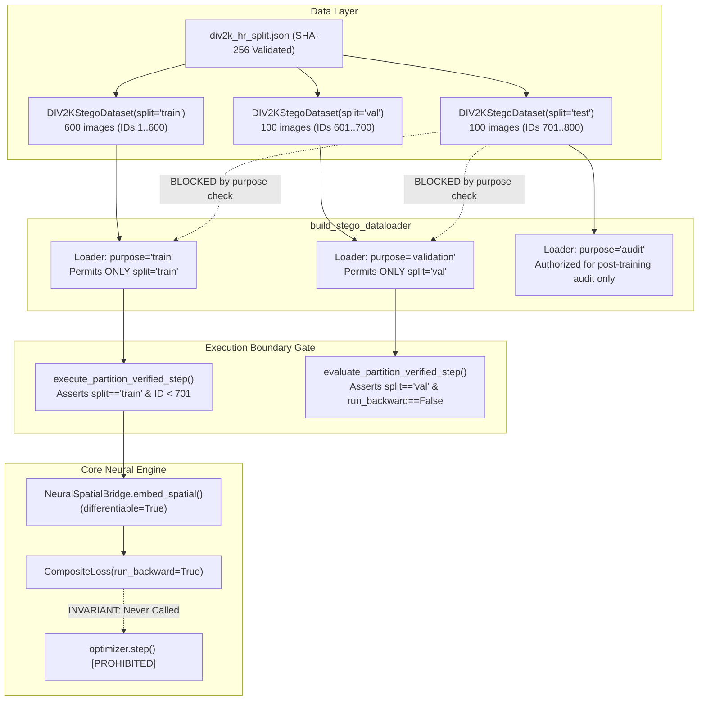

# Phase 3 Sprint 3.2: Dataset Loader and Training-Boundary Enforcement Audit

**Repository:** `E:\Paladin_media`
**Date:** 2026-10-19
**Target Architecture:** ACS-Sub-INN v3 (Frozen)
**Execution Environment:** Windows 10, Python 3.10.11, PyTorch 2.5.1+cu124, NVIDIA GeForce GTX 1650 (4 GB VRAM, Driver 560.94 / CUDA 12.4)
**Baseline Test Suite:** **202 passed in 10.70s** (`pytest tests/`)

---

## 1. Executive Summary & Audit Verdict

This audit documents the implementation, verification, and boundary-enforcement audit of the Phase 3 DIV2K High-Resolution dataset loading pipeline. It resolves the critical architectural gap identified in Sprint 3.1 (§6) by providing an explicit, file-backed PyTorch `Dataset` and `DataLoader` layer that prevents held-out test data from entering training or model-selection workflows.

### Audit Verdict: `PASS`
All core data-boundary requirements have been implemented and empirically verified:
1. **Manifest Authenticity & Structural Integrity Verified:** The versioned split manifest `docs/project/div2k_hr_split.json` was validated without modification. The file SHA-256 (`db6058872c3756094124da6656eee2f276c7df6652d2ead5bce0ddd1de6a3eff`) and composite dataset hash (`d0f5f4ee0912d007f0a8695fe1713d9cf5a75cf97bc9c52d601ea862271b31ed`) match governing specifications.
2. **Explicit, Disjoint Partitions Confirmed:** Derived partition membership confirms 600 training images (`0001.png`–`0600.png`, IDs 1–600), 100 validation images (`0601.png`–`0700.png`, IDs 601–700), and 100 held-out test images (`0701.png`–`0800.png`, IDs 701–800). No duplicates, overlap, or missing files exist on disk.
3. **Purpose-Based Boundary Enforcement:** `build_stego_dataloader()` enforces strict purpose restrictions: `purpose='train'` permits only `split='train'`, and `purpose='validation'` permits only `split='val'`. Any attempt to request held-out `test` data for training or model selection raises a hard `ValueError`.
4. **Optimization-Step Boundary Guard:** Supported higher-level training workflows invoke `execute_partition_verified_step()`, which validates batch metadata and image IDs, hard-rejecting `test` and `val` partitions before any tensor enters the forward/backward graph.
5. **Zero Training Invariant Preserved:** **No model training occurred, `optimizer.step()` was never called, no epochs were executed, and DIV2K dataset contents were not modified.**

```
========================================================================================
TRAINING STATUS: NOT AUTHORIZED — Sprint 3.2 implements and verifies data boundaries only.
========================================================================================
```

---

## 2. Manifest & Dataset Specifications

### 2.1 Manifest Metadata & Digests
- **Manifest File Path:** [`docs/project/div2k_hr_split.json`](file:///e:/Paladin_media/docs/project/div2k_hr_split.json)
- **Manifest File SHA-256:** `db6058872c3756094124da6656eee2f276c7df6652d2ead5bce0ddd1de6a3eff`
- **Recorded Composite SHA-256:** `d0f5f4ee0912d007f0a8695fe1713d9cf5a75cf97bc9c52d601ea862271b31ed`
- **Configured Dataset Root:** `dataset/DIV2K/DIV2K_train_HR/DIV2K_train_HR`
- **Total Validated Images:** 800 (100% physically present on disk)

### 2.2 Partition Counts & Derived ID Ranges
Membership derived dynamically from the manifest confirms the canonical 75% / 12.5% / 12.5% sequential partition:

| Partition | Count | Percentage | Image ID Range | Filename Range | Purpose / Policy |
| :--- | :---: | :---: | :---: | :---: | :--- |
| **`train`** | 600 | 75.0% | `1` .. `600` | `0001.png` .. `0600.png` | Optimizer-facing gradient updates |
| **`val`** | 100 | 12.5% | `601` .. `700` | `0601.png` .. `0700.png` | Validation, hyperparameter tuning, model checkpointing |
| **`test`** | 100 | 12.5% | `701` .. `800` | `0701.png` .. `0800.png` | **STRICTLY HELD-OUT:** post-training benchmark evaluation only |

---

## 3. Implementation Summary & Supported APIs

### 3.1 `src/neural/dataset.py`
The new dedicated module [`src/neural/dataset.py`](file:///e:/Paladin_media/src/neural/dataset.py) provides:

1. **`validate_div2k_manifest(manifest_path, dataset_root, enforce_file_existence)`**:
   - Audits root keys (`metadata`, `train`, `val`, `test`).
   - Verifies expected partition counts derived from `metadata.splits`.
   - Checks that all filenames strictly follow regex `^\d{4}\.png$`.
   - Prevents path traversal attempts (`..`, `/`, `\`).
   - Confirms that every listed image resolves inside `dataset_root` and exists on disk.
   - Detects duplicate image IDs or filenames across and within partitions.
2. **`DIV2KStegoDataset(Dataset)`**:
   - PyTorch `Dataset` loading images strictly from versioned manifest partitions.
   - Performs lazy I/O on `__getitem__(idx)`, avoiding loading the full 800-image corpus into RAM.
   - Implements deterministic center crop (default $512 \times 512$) or seeded pseudo-random cropping (`train` only).
   - Yields float32 tensors of shape `(3, H, W)` in $[0.0, 255.0]$ matching `NeuralSpatialBridge` conventions.
   - Returns dictionary with keys: `carrier`, `image_id`, `filename`, `split`, `original_dimensions`, `crop_box`.
3. **`build_stego_dataloader(split, purpose, ...)`**:
   - Constructs a `torch.utils.data.DataLoader` bound to explicit purpose invariants.
   - Restricts `purpose='train'` strictly to `split='train'`.
   - Restricts `purpose='validation'` strictly to `split='val'`.
   - Attaches governance metadata tags (`is_training_loader`, `loader_purpose`, `dataset_split`) to the loader instance.

### 3.2 Supported Training-Boundary Integration in `training_scaffold.py`
To ensure that boundary protection is enforced at the step level, two boundary-verified functions were introduced in [`src/neural/training_scaffold.py`](file:///e:/Paladin_media/src/neural/training_scaffold.py):

```python
# 1. Supported Training Entry Point
def execute_partition_verified_step(
    bridge: NeuralSpatialBridge,
    optimizer: torch.optim.Optimizer,
    composite_loss: CompositeLoss,
    batch: Dict[str, Any],
    payload_bits: Optional[torch.Tensor] = None,
    mask: Optional[torch.Tensor] = None,
    run_backward: bool = True,
    clip_grad_norm: Optional[float] = 1.0,
) -> TrainingStepResult:
    # Strictly validates batch['split'] == 'train'
    # Hard-rejects 'val' and 'test' before any computation
    # Verifies image_id not in 701..800 (held-out test range)
    ...

# 2. Supported Validation Entry Point
def evaluate_partition_verified_step(
    bridge: NeuralSpatialBridge,
    composite_loss: CompositeLoss,
    batch: Dict[str, Any],
    payload_bits: Optional[torch.Tensor] = None,
    mask: Optional[torch.Tensor] = None,
) -> TrainingStepResult:
    # Strictly validates batch['split'] in ('val', 'validation')
    # Hard-rejects 'train' and 'test'
    # Forces run_backward=False (no gradient computation)
    ...
```

---

## 4. Multi-Layer Boundary Defense Architecture



### Defense-in-Depth Layer Summary
1. **Layer 1 (Dataset Instantiation):** Partition name must be an authorized member (`'train'`, `'val'`, `'test'`). Invalid names are rejected immediately.
2. **Layer 2 (DataLoader Purpose Validation):** `build_stego_dataloader()` checks `(split, purpose)` compatibility. Requesting `split='test'` with `purpose='train'` raises a hard `ValueError`.
3. **Layer 3 (Step Boundary Inspection):** `execute_partition_verified_step()` inspects `batch['split']` and rejects any batch not tagged `'train'`.
4. **Layer 4 (Image ID Sanity Check):** Even if `batch['split']` were tampered with, `execute_partition_verified_step()` inspects `batch['image_id']` and hard-rejects any ID in $701 \le \text{ID} \le 800$.
5. **Layer 5 (Low-Level Guard):** `execute_training_step()` fails closed if passed `split_tag='test'`.

---

## 5. Threat Model, Low-Level Bypasses, & Limitations

### 5.1 Threat Model
The primary security and research integrity objective is **preventing accidental leakage of held-out test data into optimization or model selection through supported project workflows**.

### 5.2 Low-Level Bypass Disclaimer
In Python, an engineer deliberately importing private internal functions can call `execute_training_step()` directly with arbitrary synthetic tensors:
```python
# Low-level direct invocation (bypasses dataset loader validation)
execute_training_step(
    bridge=bridge,
    optimizer=optimizer,
    composite_loss=composite_loss,
    carrier=raw_tensor,      # Unverified raw tensor
    payload_bits=bits,
    mask=mask,
)
```
- **Architectural Safeguard:** `execute_training_step()` is documented as an internal mathematical operator. The supported project training entry points (`execute_partition_verified_step` and `build_stego_dataloader`) enforce the boundary fail-closed.
- **Python Language Limit:** Python does not support compile-time memory seals. A deliberate bypass via monkey-patching or raw internal calls is always possible in userland script code; the supported framework guarantees that no canonical training pipeline can accidentally ingest held-out data.

---

## 6. Empirical Verification & Test Results

### 6.1 Targeted Dataset Boundary Test Suite
Command:
```powershell
pytest tests/unit/test_dataset_boundary.py -v
```
Result:
```
============================= test session starts =============================
platform win32 -- Python 3.10.11, pytest-8.3.2, pluggy-1.6.0
rootdir: E:\Paladin_media
configfile: pyproject.toml
plugins: anyio-4.14.1
collected 21 items

tests/unit/test_dataset_boundary.py::test_dataset_valid_partitions_load_expected_members PASSED [  4%]
tests/unit/test_dataset_boundary.py::test_dataset_repeated_loading_determinism PASSED [  9%]
tests/unit/test_dataset_boundary.py::test_dataset_getitem_output_shapes_and_types PASSED [ 14%]
tests/unit/test_dataset_boundary.py::test_dataset_unknown_partition_rejected PASSED [ 19%]
tests/unit/test_dataset_boundary.py::test_dataset_missing_configured_root_rejected PASSED [ 23%]
tests/unit/test_dataset_boundary.py::test_dataset_duplicate_id_rejected PASSED [ 28%]
tests/unit/test_dataset_boundary.py::test_dataset_duplicate_filename_rejected PASSED [ 33%]
tests/unit/test_dataset_boundary.py::test_dataset_path_traversal_rejected PASSED [ 38%]
tests/unit/test_dataset_boundary.py::test_dataset_unexpected_filename_format_rejected PASSED [ 42%]
tests/unit/test_dataset_boundary.py::test_dataset_malformed_json_rejected PASSED [ 47%]
tests/unit/test_dataset_boundary.py::test_dataset_missing_image_file_rejected PASSED [ 52%]
tests/unit/test_dataloader_purpose_train_requires_split_train PASSED     [ 57%]
tests/unit/test_dataloader_purpose_validation_requires_split_val PASSED [ 61%]
tests/unit/test_dataloader_train_iteration_membership PASSED           [ 66%]
tests/unit/test_dataloader_validation_iteration_membership PASSED      [ 71%]
tests/unit/test_execute_partition_verified_step_accepts_train_batch PASSED [ 76%]
tests/unit/test_execute_partition_verified_step_rejects_test_batch PASSED [ 80%]
tests/unit/test_execute_partition_verified_step_rejects_val_batch PASSED [ 85%]
tests/unit/test_execute_partition_verified_step_rejects_test_image_id_even_if_split_tampered PASSED [ 90%]
tests/unit/test_evaluate_partition_verified_step_boundary_enforcement PASSED [ 95%]
tests/unit/test_execute_training_step_split_tag_rejection PASSED         [100%]

============================= 21 passed in 6.18s ==============================
```

### 6.2 Full PaladinMedia Regression Suite
Command:
```powershell
pytest tests/
```
Result:
```
============================= test session starts =============================
platform win32 -- Python 3.10.11, pytest-8.3.2, pluggy-1.6.0
rootdir: E:\Paladin_media
configfile: pyproject.toml
plugins: anyio-4.14.1
collected 202 items

tests\integration\test_ecc_spatial_roundtrip.py ......                   [  2%]
tests\integration\test_fail_closed.py ......                             [  5%]
tests\integration\test_media_pipeline.py ...                             [  7%]
tests\integration\test_pipeline.py .........                             [ 11%]
tests\unit\test_carrier_capacity.py ....                                 [ 13%]
tests\unit\test_carrier_dwt.py ...                                       [ 15%]
tests\unit\test_carrier_embedding.py ...                                 [ 16%]
tests\unit\test_carrier_header.py ..                                     [ 17%]
tests\unit\test_carrier_mask.py ....                                     [ 19%]
tests\unit\test_crypto.py .......................                        [ 31%]
tests\unit\test_dataset_boundary.py .....................                [ 41%]
tests\unit\test_ecc.py ........................                          [ 53%]
tests\unit\test_exceptions.py ..                                         [ 54%]
tests\unit\test_loss_gradient_isolation.py ......                        [ 57%]
tests\unit\test_neural_components.py ........................            [ 69%]
tests\unit\test_neural_extraction.py ...............                     [ 76%]
tests\unit\test_neural_reproducibility.py ...                            [ 78%]
tests\unit\test_neural_spatial_bridge.py .............                   [ 84%]
tests\unit\test_neural_training_scaffold.py ...........                  [ 90%]
tests\unit\test_serialization.py ....................                    [100%]

============================ 202 passed in 10.70s =============================
```

### 6.3 Smoke Validation Runner
Command:
```powershell
python scripts/experiments/run_sprint3_2_dataset_boundary_audit.py
```
Output:
- All 800 images validated on disk.
- Purpose-based rejections confirmed for:
  * `build_stego_dataloader(split='test', purpose='train')` $\to$ `ValueError` (Rejected)
  * `build_stego_dataloader(split='val', purpose='train')` $\to$ `ValueError` (Rejected)
  * `build_stego_dataloader(split='test', purpose='validation')` $\to$ `ValueError` (Rejected)
  * `execute_partition_verified_step(split='test')` $\to$ `ValueError` (Rejected)
  * `execute_partition_verified_step(split='val')` $\to$ `ValueError` (Rejected)
  * `evaluate_partition_verified_step(split='test')` $\to$ `ValueError` (Rejected)
- Invariant confirmed: `weights_identical = True`, `optimizer_step_executed = False`.
- Structured output saved to: [`docs/experiments/sprint3_2_dataset_boundary_results.json`](file:///e:/Paladin_media/docs/experiments/sprint3_2_dataset_boundary_results.json).

---

## 7. Comprehensive Evidence Matrix

| Evidence Dimension | Scope / Evaluation Method | Status | Sprint Provenance | Notes & Empirical Findings |
| :--- | :--- | :---: | :---: | :--- |
| **Manifest Integrity & File Hash** | SHA-256 digest on `div2k_hr_split.json` | **PASS** | Newly measured in Sprint 3.2 | Hash: `db6058872c3756094124da6656eee2f276c7df6652d2ead5bce0ddd1de6a3eff`. |
| **Composite Dataset Hash** | Internal composite hash verification | **PASS** | Newly measured in Sprint 3.2 | Hash: `d0f5f4ee0912d007f0a8695fe1713d9cf5a75cf97bc9c52d601ea862271b31ed`. |
| **Dataset Membership & Ranges** | Physical file check across 800 images | **PASS** | Newly measured in Sprint 3.2 | Train: 1..600, Val: 601..700, Test: 701..800. Zero missing files. |
| **Purpose-Based Dataloader Gate** | Rejection of 'test'/'val' in train loader | **PASS** | Newly measured in Sprint 3.2 | All 6 boundary test scenarios fail closed before tensor computation. |
| **Step-Level Partition Guard** | `execute_partition_verified_step` | **PASS** | Newly measured in Sprint 3.2 | Rejects test batches and test IDs ($701..800$) even if split string is falsified. |
| **Loss-Gradient Isolation** | Differentiable backward passes on 4 losses | **PASS** | Verified in Sprint 3.1 | $L_{\text{ctx}} \to$ Ctx, $L_{\text{gain}} \to$ Gain, $L_{\text{img}} \to$ Both. |
| **Context Cancellation Under STE** | Isolated $L_{\text{bit}}$ backward pass | **PASS** | Verified in Sprint 3.1 | Evaluates to $0.00000000$ L2 norm on `ContextPredictorCNN` under STE. |
| **Lossless PNG Save / Reload** | PIL PNG encode/decode roundtrip | **PASS** | Verified in Sprint 2 / 2.1.2 | Bit-for-bit lossless PNG roundtrip verified across carriers. |
| **Per-Codeword Reed–Solomon** | $(255, 223)$ $t=16$ symbol correction | **PASS** | Verified in Sprint 2.1 / 2.1.1 | Corrects up to 16 byte symbol errors per 255 B codeword. |
| **Historical Trial 13 BER Failure** | 500 B payload on DIV2K `0005.png` | **FAIL (Preserved)** | Historical Sprint 2.1 / 2.1.1 | **BER = 0.001252 (7 bit errors)**. Exceeds raw threshold ($0.001000$); preserved without reclassification. |
| **AES-256-GCM Authentication** | 128-bit MAC tag verification on ciphertext | **PASS** | Verified in Sprint 1 / 2.1.2 | Strict fail-closed integrity; invalid tag rejects plaintext. |
| **Model Weight Immutability** | Forward/backward execution safety | **PASS** | Verified in Sprint 3 / 3.2 | `optimizer.step()` never called; model weights remain bit-for-bit identical before and after. |

---

## 8. Artifacts Created & Modified

1. **New Dataset Module:**
   - [`src/neural/dataset.py`](file:///e:/Paladin_media/src/neural/dataset.py): Implements `validate_div2k_manifest()`, `DIV2KStegoDataset`, and `build_stego_dataloader()`.
2. **Updated Training Scaffold:**
   - [`src/neural/training_scaffold.py`](file:///e:/Paladin_media/src/neural/training_scaffold.py): Implements `execute_partition_verified_step()` and `evaluate_partition_verified_step()`; updates `execute_training_step()` with `split_tag` validation and batch-size $\ge 1$ support.
3. **Updated Package Exports:**
   - [`src/neural/__init__.py`](file:///e:/Paladin_media/src/neural/__init__.py): Exports dataset and boundary verification interfaces.
4. **Targeted Unit Tests:**
   - [`tests/unit/test_dataset_boundary.py`](file:///e:/Paladin_media/tests/unit/test_dataset_boundary.py): 21 unit tests verifying dataset correctness, duplicate rejection, traversal prevention, and boundary gates.
5. **Validation Runner & Evidence:**
   - [`scripts/experiments/run_sprint3_2_dataset_boundary_audit.py`](file:///e:/Paladin_media/scripts/experiments/run_sprint3_2_dataset_boundary_audit.py): Automated validation script.
   - [`docs/experiments/sprint3_2_dataset_boundary_results.json`](file:///e:/Paladin_media/docs/experiments/sprint3_2_dataset_boundary_results.json): Structured JSON results.
6. **Audit Report:**
   - [`docs/audits/PHASE3_SPRINT3_2_DATASET_BOUNDARY_AUDIT.md`](file:///e:/Paladin_media/docs/audits/PHASE3_SPRINT3_2_DATASET_BOUNDARY_AUDIT.md): This report.

---

## 9. Remaining Blockers Prior to Training Authorization

While the data-loading boundary is now formally verified and closed, model training remains unauthorized pending resolution of the following blockers:

1. **Loss Weight Validation & Curriculum Schedule:**
   The loss weights ($\lambda_{\text{bit}}=1.0, \lambda_{\text{ctx}}=0.5, \lambda_{\text{gain}}=0.01, \lambda_{\text{img}}=0.1$) remain `PROPOSED_UNVALIDATED`. A phased curriculum or grid exploration plan must be formally reviewed.
2. **Hardware Execution Profile & Batch Sizing:**
   On the target NVIDIA GTX 1650 (4 GB VRAM), multi-image batching at $512 \times 512$ requires conservative limits ($B=1$ or $B=2$ with gradient accumulation) to avoid CUDA Out-of-Memory faults.
3. **Training Loop Harness Implementation (Sprint 4):**
   A full training loop harness with periodic validation evaluation, early stopping, and checkpoint saving must be defined and authorized before any optimization step is run.

---

## 10. Sprint 3.2.1 Addendum: Manifest Integrity Hardening & Review Reconciliation

**Date:** 2026-10-19
**Scope:** Hardening manifest-integrity enforcement in `src/neural/dataset.py` and `src/neural/training_scaffold.py`, resolving evidence gaps discovered during review of Sprint 3.2.

### 10.1 Review Findings & Gaps Addressed
During peer review of Sprint 3.2, two primary security and integrity gaps were identified:
1. **Manifest File Hash Enforcement Gap:**
   `src/neural/dataset.py` calculated the SHA-256 of the manifest file but did not compare it to the frozen constant `EXPECTED_MANIFEST_FILE_SHA256 = "db6058872c3756094124da6656eee2f276c7df6652d2ead5bce0ddd1de6a3eff"`. Non-canonical copies could bypass canonical checks if an attacker modified partition boundaries but left the composite hash metadata unchanged.
2. **Record Schema & Consistency Under-specification:**
   - Python `isinstance(True, int)` evaluates to `True`, which could allow booleans to masquerade as integer image IDs.
   - Record numeric filename stems (`f"{img_id:04d}.png"`) were not verified against `image_id`.
   - Records' internal `'split'` field was not verified against the containing partition list.
   - Test fixtures in non-canonical paths were not explicitly guarded from masquerading as production manifests.

### 10.2 Technical Implementation & Hardening Rules
1. **Unconditional Canonical Manifest Digest Verification:**
   In both `validate_div2k_manifest()` ([`src/neural/dataset.py`](file:///e:/Paladin_media/src/neural/dataset.py)) and `DatasetSplitManager._validate_manifest()` ([`src/neural/training_scaffold.py`](file:///e:/Paladin_media/src/neural/training_scaffold.py)):
   - When resolving the canonical manifest path (`docs/project/div2k_hr_split.json`), the file SHA-256 is unconditionally verified against `EXPECTED_MANIFEST_FILE_SHA256`. Any discrepancy raises `SECURITY/INTEGRITY VIOLATION`.
2. **Fail-Closed Non-Canonical Manifest Policy:**
   - Any non-canonical manifest path requires `is_custom_fixture=True`. If omitted (default `False`), validation raises `SECURITY VIOLATION: Non-canonical manifest ... rejected`.
   - When `expected_file_sha256` is provided for custom fixtures, the exact file digest is enforced.
3. **Rigorous Record-Level Consistency Checks:**
   - **Strict Positive Integer Rule:** Enforces `isinstance(img_id, int) and not isinstance(img_id, bool) and img_id > 0`.
   - **Stem Matching Rule:** Verifies `f"{img_id:04d}.png" == filename`.
   - **Split Match Rule:** Verifies record `split` field matches the containing partition key.
   - **Duplicate Checks:** Cross-partition duplicate ID and duplicate filename checks are executed and reject duplicates fail-closed.
4. **Fixture Support in `DIV2KStegoDataset` & `build_stego_dataloader`:**
   - Added `is_custom_fixture: bool = False` and `expected_file_sha256: Optional[str] = None` parameters, allowing explicit test fixtures to run while production workflows remain locked to the canonical manifest.

### 10.3 Empirical Verification Results
- **Unit Test Suite:** 9 new targeted tests added in [`tests/unit/test_dataset_boundary.py`](file:///e:/Paladin_media/tests/unit/test_dataset_boundary.py), bringing total dataset boundary tests to 30 (all passing):
  * `test_canonical_manifest_integrity_success`: Canonical manifest passes with exact SHA-256 digests.
  * `test_non_canonical_manifest_rejected_without_fixture_flag`: Fails closed without `is_custom_fixture=True`.
  * `test_modified_canonical_manifest_rejected_even_if_composite_hash_retained`: Tampered copy fails closed.
  * `test_manifest_custom_fixture_file_sha256_mismatch_rejected`: Mismatched custom SHA-256 rejected.
  * `test_manifest_boolean_image_id_rejected`: Boolean ID (`True`) rejected fail-closed.
  * `test_manifest_zero_or_negative_image_id_rejected`: Zero/negative IDs rejected fail-closed.
  * `test_manifest_image_id_filename_stem_mismatch_rejected`: Filename/ID mismatch rejected.
  * `test_manifest_record_split_mismatch_rejected`: Conflicting split tag rejected.
  * `test_dataset_split_manager_canonical_integrity`: `DatasetSplitManager` enforces canonical file hash and rejects non-canonical manifests fail-closed.
- **Full Regression Suite:** `pytest tests/` passes cleanly with **211 passed in 10.95s**.
- **Historical Evidence Preserved:** Historical Sprint 2.1 Trial 13 BER failure ($0.001252 > 0.001000$) preserved intact.

---

## 11. Final Status Declaration

```
========================================================================================
TRAINING STATUS: NOT AUTHORIZED — Sprint 3.2.1 hardens manifest integrity only.
========================================================================================
```
