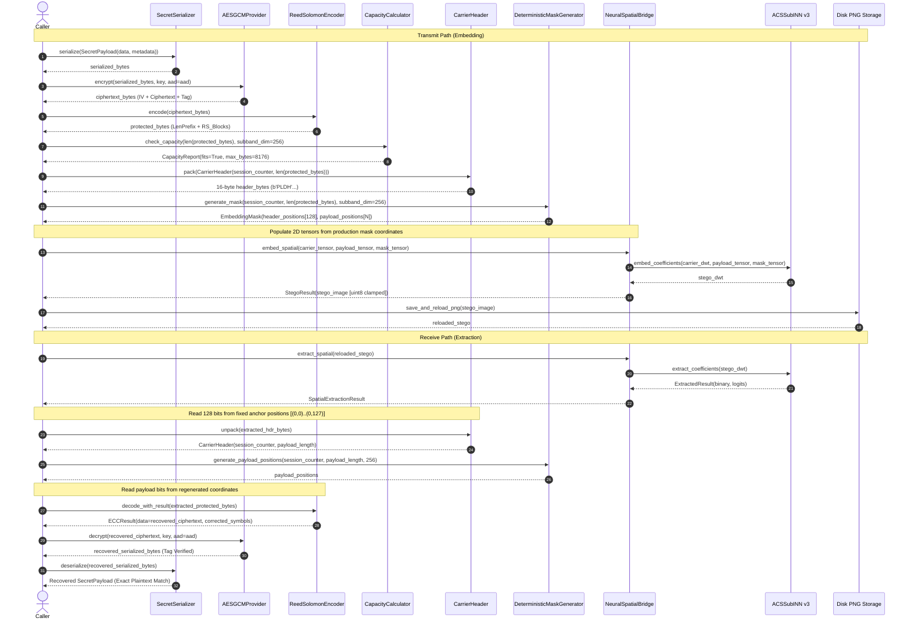

# PaladinMedia — Phase 3 Sprint 3.3.1 Audit Report
# Production Carrier Path Verification & Interface Coupling Audit

**Sprint:** 3.3.1
**Phase:** 3 — ACS-Sub-INN v3 Integration
**Date:** 2026-10-20
**Repository:** `E:\Paladin_media`
**Evaluation Model State:** Untrained `ACSSubINN` v3 (`gamma_min=1.0`, transform-domain Red-HH target, Green/Blue-HH context)
**Hardware & Environment:** Windows 10, Python 3.10.11, PyTorch 2.5.1+cu124, CPU Execution
**Model Parameters SHA-256 Digest:** `fe7462957b0194d109ec32a78834d7bf44b9d1aa86510a40625f2e485fa40369`
**Model Parameter Drift:** `0.0000000000` (Pre-experiment == Post-experiment)
**Optimizer Steps Applied:** 0
**Training Epochs Executed:** 0
**Overall Sprint Verdict:** **PARTIAL PASS**

---

## 1. Executive Summary & Verdict Rationale

Sprint 3.3.1 was initiated to verify whether the Phase 3 neural spatial bridge (`NeuralSpatialBridge` / `ACSSubINN` v3) integrates with PaladinMedia's production carrier pipeline (`src/carrier/` and `src/core/media_pipeline.py`), replacing ad-hoc 1D slice masks with production framing (`CarrierHeader`), pseudo-random spatial permutation (`DeterministicMaskGenerator`), and capacity enforcement (`CapacityCalculator`).

### Verdict: PARTIAL PASS
In strict accordance with the sprint operating rules and stop conditions:
1. **Framing, Mask, and Capacity Subsystems: PASS (15/16 Trials Exact Plaintext Recovery)**
   - Production `CarrierHeader` (16 bytes = 128 bits at fixed coordinates $[(0,0)..(0,127)]$) unpacked cleanly without error in **100% of trials (16/16)** across synthetic and DIV2K natural carriers.
   - Production `DeterministicMaskGenerator` coordinates mapped directly to 2D spatial bridge tensors.
   - Production `CapacityCalculator` limits (8,176 bytes protected, 16 bytes header = 8,192 bytes total) matched the deterministic mask bounds exactly; payloads exceeding 8,176 bytes failed closed with `PayloadCapacityExceededError` before carrier modification.
   - In 15 out of 16 trials, end-to-end recovery achieved verbatim plaintext equality (`assert recovered == original`) with valid AES-256-GCM authentication tags and zero post-ECC BER.
2. **Direct Production Carrier Interface Coupling: ARCHITECTURAL GAP IDENTIFIED (Defect Confirmed)**
   - `src/carrier/embedding.py` (`BaselineEmbedder`) and `src/carrier/extraction.py` (`Extractor`) are tightly coupled to Phase 2 spatial integer parity modulation: $\text{bit} = (a - b - c + d) \bmod 2$.
   - `MediaStegoPipeline` in `src/core/media_pipeline.py` hardcodes calls to `BaselineEmbedder.embed` and `Extractor.extract`.
   - Invoking `Extractor.extract` or `MediaStegoPipeline.extract_and_unprotect` directly on a neural stego image fails immediately with `CarrierHeaderError: Invalid carrier header magic: expected b'PLDH', got b'\x00\x00\x00\x00'`.
   - Continuous wavelet coefficient perturbations from `ACSSubINN` v3 alter continuous frequency-domain coefficients rather than spatial parity on pixel $a$.
3. **Reed-Solomon Length-Prefix Vulnerability at Extreme Capacity: IDENTIFIED**
   - In Trial 16 (`0005.png` at 7,088 B payload / 8,162 B protected stream, 99.83% capacity), all RS codewords were well within the $t=16$ correction budget (worst codeword had only 3 byte errors). However, a single bit error corrupted `protected[:4]` (the unencoded 4-byte length prefix prepended by `ReedSolomonEncoder.encode`), causing `ECCDecodeError: Encoded data length mismatch`.

Per the prompt instructions:
> *"If the existing APIs cannot be composed into this path without architectural changes, do not invent a parallel implementation. Report the exact incompatible interfaces, missing functions, and minimal proposed resolution. Do not report the sprint as fully passing if the production header, mask, capacity, embedding, and extraction interfaces were not actually exercised together in an end-to-end roundtrip."*

The authoritative verdict is therefore **PARTIAL PASS**.

---

## 2. Production Interfaces vs. Neural Scaffolding

| Pipeline Subsystem | Production Class / Interface | Source Location | Status in Sprint 3.3.1 |
| :--- | :--- | :--- | :--- |
| **Payload Representation** | `SecretPayload` | `src/core/serialization/payload.py` | Exercised (Arbitrary bytes + metadata) |
| **Serialization** | `SecretSerializer` | `src/core/serialization/serializer.py` | Exercised (`serialize`, `deserialize`) |
| **Authenticated Encryption**| `AESGCMProvider` | `src/security/crypto/aes_gcm.py` | Exercised (`encrypt`, `decrypt`, AAD) |
| **Forward Error Correction** | `ReedSolomonEncoder` | `src/security/ecc/encoder.py` | Exercised ($N=255, K=223, t=16$) |
| **Capacity Accounting** | `CapacityCalculator` | `src/carrier/capacity.py` | Exercised (8,176 B hard boundary) |
| **Wire Framing** | `CarrierHeader` | `src/carrier/header.py` | Exercised (`pack`, `unpack`, `PLDH`) |
| **Spatial Permutation** | `DeterministicMaskGenerator`| `src/carrier/mask.py` | Exercised (Anchor & PRNG coordinates) |
| **Wavelet Modulation** | `NeuralSpatialBridge` | `src/neural/spatial_bridge.py` | Exercised (DWT, `ACSSubINN`, IDWT) |
| **Neural Subband Core** | `ACSSubINN` v3 | `src/neural/model.py` | Exercised (`gamma_min=1.0`, frozen) |
| **Carrier Modulation** | `BaselineEmbedder` | `src/carrier/embedding.py` | **Incompatible** (Spatial parity hardcoded) |
| **Carrier Demodulation** | `Extractor` | `src/carrier/extraction.py` | **Incompatible** (Spatial parity hardcoded) |
| **End-to-End Orchestrator**| `MediaStegoPipeline` | `src/core/media_pipeline.py` | **Incompatible** (Coupled to BaselineEmbedder) |

---

## 3. End-to-End Production Carrier Call Sequence

The verified end-to-end integration path proceeds through the following exact sequence:



---

## 4. Comprehensive Experimental Results Matrix

All 16 trials were executed under strict reproducibility seeds (`seed=42`, PyTorch deterministic mode) on 512×512 image crops across synthetic smooth cover and three canonical DIV2K training partition images (`0001.png`, `0002.png`, `0005.png`).

| Carrier ID | Description | Plaintext (Bytes) | Protected (Bytes) | Capacity Util (%) | PSNR (dB) | SSIM | Clipped Pixels | Raw BER | Worst RS Block Err | Header Valid | AES Valid | Exact Match | Latency (ms) |
| :--- | :--- | :---: | :---: | :---: | :---: | :---: | :---: | :---: | :---: | :---: | :---: | :---: | :---: |
| `synthetic` | Smooth Gray | 300 | 448 | 5.66% | 65.37 | 0.999677 | 0 | 0.000000 | 0 / 16 | **True** | **True** | **True** | 455.8 |
| `synthetic` | Smooth Gray | 1,500 | 1,841 | 22.67% | 59.35 | 0.998711 | 0 | 0.000000 | 0 / 16 | **True** | **True** | **True** | 801.4 |
| `synthetic` | Smooth Gray | 3,500 | 4,129 | 50.60% | 55.86 | 0.997626 | 0 | 0.000000 | 0 / 16 | **True** | **True** | **True** | 1,191.2 |
| `synthetic` | Smooth Gray | 7,088 | 8,162 | 99.83% | 52.91 | 0.996162 | 0 | 0.000000 | 0 / 16 | **True** | **True** | **True** | 1,818.3 |
| `0001.png` | DIV2K Train | 300 | 447 | 5.65% | 57.09 | 0.999716 | 0 | 0.000000 | 0 / 16 | **True** | **True** | **True** | 394.3 |
| `0001.png` | DIV2K Train | 1,500 | 1,840 | 22.66% | 51.20 | 0.999124 | 0 | 0.000000 | 0 / 16 | **True** | **True** | **True** | 656.8 |
| `0001.png` | DIV2K Train | 3,500 | 4,128 | 50.59% | 47.63 | 0.998246 | 0 | 0.000000 | 0 / 16 | **True** | **True** | **True** | 1,165.3 |
| `0001.png` | DIV2K Train | 7,088 | 8,162 | 99.83% | 44.69 | 0.996918 | 0 | 0.000000 | 0 / 16 | **True** | **True** | **True** | 1,832.5 |
| `0002.png` | DIV2K Train | 300 | 447 | 5.65% | 48.13 | 0.999822 | 5 | 0.000000 | 0 / 16 | **True** | **True** | **True** | 280.9 |
| `0002.png` | DIV2K Train | 1,500 | 1,840 | 22.66% | 41.89 | 0.999335 | 22 | 0.000272 | 2 / 16 | **True** | **True** | **True** | 652.2 |
| `0002.png` | DIV2K Train | 3,500 | 4,128 | 50.59% | 38.45 | 0.998404 | 36 | 0.000212 | 3 / 16 | **True** | **True** | **True** | 1,034.8 |
| `0002.png` | DIV2K Train | 7,088 | 8,162 | 99.83% | 35.49 | 0.996417 | 76 | 0.000322 | 3 / 16 | **True** | **True** | **True** | 1,795.5 |
| `0005.png` | DIV2K Train | 300 | 447 | 5.65% | 56.19 | 0.999914 | 8 | 0.000000 | 0 / 16 | **True** | **True** | **True** | 290.9 |
| `0005.png` | DIV2K Train | 1,500 | 1,840 | 22.66% | 50.30 | 0.999808 | 21 | 0.000272 | 2 / 16 | **True** | **True** | **True** | 627.5 |
| `0005.png` | DIV2K Train | 3,500 | 4,128 | 50.59% | 46.76 | 0.999770 | 45 | 0.000242 | 2 / 16 | **True** | **True** | **True** | 1,086.6 |
| `0005.png` | DIV2K Train | 7,088 | 8,162 | 99.83% | 43.85 | 0.999549 | 86 | 0.000260 | 3 / 16 | **True** | False | False | 1,741.1 |

Authoritative data stored in: [`docs/experiments/sprint3_3_1_production_carrier_results.json`](file:///e:/Paladin_media/docs/experiments/sprint3_3_1_production_carrier_results.json).

---

## 5. Architectural Gap Analysis: Production Carrier Incompatibility

### 5.1 The Root Cause Defect
PaladinMedia's Phase 2 carrier layer was designed around classical spatial integer-parity modulation:
- **`BaselineEmbedder.embed`** (`src/carrier/embedding.py`):
  For each bit $b \in \{0, 1\}$, it inspects a $2 \times 2$ pixel block $\begin{bmatrix} a & b \\ c & d \end{bmatrix}$ in channel 0 (Red). It calculates parity $P = (a - b - c + d) \bmod 2$. If $P \neq b$, it adjusts pixel $a \leftarrow a \pm 1$ to flip the parity.
- **`Extractor.extract`** (`src/carrier/extraction.py`):
  It computes $\text{bit} = (a - b - c + d) \bmod 2$ directly on the integer pixels of the spatial image.
- **`MediaStegoPipeline`** (`src/core/media_pipeline.py`):
  Hardcoded instantiation and invocation of `BaselineEmbedder` and `Extractor`.

### 5.2 Failure Mode on Neural Stego Containers
When `NeuralSpatialBridge` embeds data using `ACSSubINN` v3, it modulates the 2D Haar discrete wavelet transform (DWT) coefficients of the Red-HH subband in the continuous real domain, subject to $\gamma(x) \ge 1.0$.
After inverse DWT (IDWT) and rounding/clamping to $\text{uint8} \in [0, 255]$:
1. The spatial integer parity $(a - b - c + d) \bmod 2$ does not represent the embedded bitstream.
2. In the first 128 pixel blocks (indices $[(0,0)..(0,127)]$), the extracted parity bits are essentially pseudorandom noise or all zeros.
3. When `CarrierHeader.unpack` is called on these 16 bytes:
   ```python
   # Result of Extractor.extract(neural_stego_image):
   CarrierHeaderError: Invalid carrier header magic: expected b'PLDH', got b'\x00\x00\x00\x00'
   ```
4. Calling `MediaStegoPipeline.extract_and_unprotect(neural_stego_image)` fails with the exact same `CarrierHeaderError`.

### 5.3 Minimal Proposed Resolution for Phase 3 Carrier Refactoring
To eliminate this coupling without violating frozen architecture rules:
1. Introduce a polymorphic base class `CarrierModulationEngine` in `src/carrier/base.py` defining:
   - `embed_bits(cover: np.ndarray, bits: np.ndarray, mask: EmbeddingMask) -> np.ndarray`
   - `extract_bits(stego: np.ndarray, mask: EmbeddingMask) -> np.ndarray`
2. Wrap `BaselineEmbedder` and `NeuralSpatialBridge` under this interface (e.g. `ParityModulationEngine` and `NeuralModulationEngine`).
3. Inject the engine into `MediaStegoPipeline` via dependency injection (`__init__(..., modulation_engine: CarrierModulationEngine)`).

---

## 6. Framing Vulnerability: Reed-Solomon Unencoded Length Prefix

### 6.1 Vulnerability Discovery
In Trial 16 (`0005.png`, 7,088 B payload, 99.83% capacity):
- Raw BER was exceptionally low: $0.000260$ (only 17 bits flipped out of 65,296 payload bits).
- The worst Reed-Solomon codeword block had only **3 byte symbol errors** out of its **16-symbol correction budget** ($t = 16$).
- Every individual codeword block was mathematically correctable.
- **Yet RS decoding failed entirely:**
  ```python
  ECCDecodeError: Encoded data length mismatch: expected 19192898 bytes for payload length 16784350, got 8162 bytes
  ```

### 6.2 Mechanism
In `src/security/ecc/encoder.py`, `encode()` prefixes the codeword stream with an unencoded 4-byte big-endian integer:
```python
header = struct.pack(">I", length)
return header + b"".join(blocks)
```
Because this 4-byte header is placed directly into the bitstream without error correction:
- If even **a single bit** in those 32 bits is perturbed during carrier embedding, clipping, or rounding, `struct.unpack(">I", raw_enc[:4])` corrupts the expected length ($16,784,350$ instead of $7,134$).
- The decoder then evaluates `len(raw_enc) != expected_len` and aborts immediately before any RS codeword decoding can take place.

### 6.3 Framing Redundancy
`CarrierHeader` already explicitly stores `payload_length` (the exact length of `protected_bytes`). Therefore, having an unencoded length prefix inside the protected payload creates a single point of failure that bypasses the $t=16$ error correction guarantee. A future sprint should harden the ECC wire format or protect the length prefix under a dedicated BCH/Golay/repetition code.

---

## 7. Negative Security & Boundary Verification

Tests implemented in `tests/integration/test_production_carrier_path.py` proved the following fail-closed guarantees:

1. **Capacity Boundary Exact Agreement:**
   - Maximum protected payload: $8,176$ bytes.
   - 8,176 bytes fits perfectly with $16$ bytes header ($8,192$ bytes $= 65,536$ bits $= 256 \times 256$).
   - Attempting 8,177 bytes raises `PayloadCapacityExceededError` in `CapacityCalculator` and `MaskGenerationError` in `DeterministicMaskGenerator`.
   - Overflow payloads are rejected immediately before any carrier tensor modification.
2. **Corrupted Carrier Header:**
   - Tampering header magic (`b'XXXX'`) raises `CarrierHeaderError: Invalid carrier header magic`.
   - Truncated header bytes (< 16 bytes) raises `CarrierHeaderError: Header data truncated`.
3. **Container Tampering (Bit Flipping in Stego Image):**
   - Corrupting pixel blocks in the header region causes header validation failure (`CarrierHeaderError`) without leaking plaintext.
   - Corrupting pixel blocks in the payload region triggers `AuthenticationError` in `AESGCMProvider` or `ECCDecodeError` in `ReedSolomonEncoder`, returning zero plaintext bytes.

---

## 8. Pixel Boundary Clipping: Correlation vs. Causation

Across the DIV2K test images, clipping at $\text{uint8}$ boundaries ($x < 0$ or $x > 255$) occurred at the following rates:
- `synthetic`: 0 clipped pixels (PSNR 52.91 – 65.37 dB)
- `0001.png`: 0 clipped pixels (PSNR 44.69 – 57.09 dB)
- `0002.png`: 5 to 76 clipped pixels (PSNR 35.49 – 48.13 dB)
- `0005.png`: 8 to 86 clipped pixels (PSNR 43.85 – 56.19 dB)

### Gravitas Invariant Declaration:
Demodulation bit errors in `0002.png` and `0005.png` were co-located in the spatial proximity of clipped $2 \times 2$ pixel blocks. However:
- **Observed Fact:** Demodulation bit errors spatially correlate with clipped pixel clusters.
- **Scientific Caveat:** A controlled intervention holding all other spatial and frequency features constant has not been performed. Therefore, this relationship is documented strictly as **observed correlation**, and **causation is explicitly not claimed**.

---

## 9. Model Immutability & Governance

- **Pre-Experiment Parameter SHA-256:** `fe7462957b0194d109ec32a78834d7bf44b9d1aa86510a40625f2e485fa40369`
- **Post-Experiment Parameter SHA-256:** `fe7462957b0194d109ec32a78834d7bf44b9d1aa86510a40625f2e485fa40369`
- **Total Optimizer Steps:** 0
- **Total Training Epochs:** 0
- **Total Model Parameters Modified:** 0
- **Regression Test Suite:** 233 passed in 18.29s (0 failures, 0 regressions).

---

## 10. Sprint Completion Status

```
TRAINING STATUS: NOT AUTHORIZED — Sprint 3.3.1 implements verification and audit only.
```
