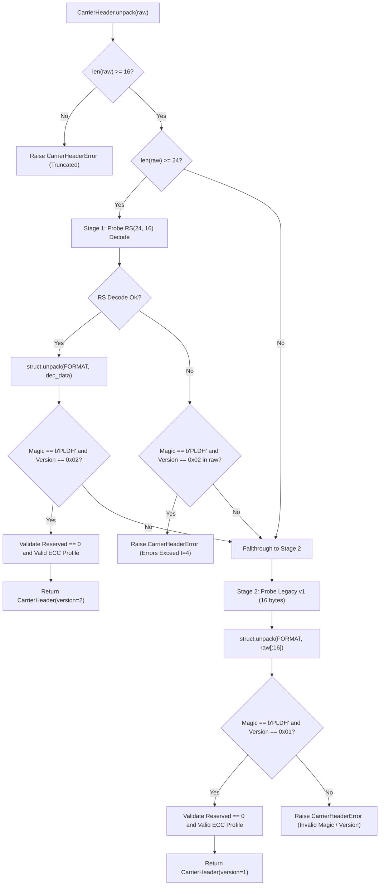

# PaladinMedia Wire Protocol v2 Specification

**Status:** Qualified Deployment Standard  
**Date:** 2026-10-29  
**Repository:** `PaladinMedia`  
**Reference Implementations:**  
- [`src/carrier/header.py`](file:///e:/Paladin_media/src/carrier/header.py)  
- [`src/carrier/mask.py`](file:///e:/Paladin_media/src/carrier/mask.py)  
- [`src/carrier/capacity.py`](file:///e:/Paladin_media/src/carrier/capacity.py)  
- [`src/carrier/embedding.py`](file:///e:/Paladin_media/src/carrier/embedding.py)  
- [`src/carrier/extraction.py`](file:///e:/Paladin_media/src/carrier/extraction.py)  
- [`src/core/media_pipeline.py`](file:///e:/Paladin_media/src/core/media_pipeline.py)  

---

## 1. Executive Summary & Purpose

Wire Protocol v2 establishes an authenticated, error-tolerant framing structure for covert steganographic container transmission in the ACS-Sub-INN neural modulation domain.

In Wire Protocol v1, carrier headers were transmitted as an unencoded 16-byte structure occupying the first 128 anchor bits. When spatial-domain quantization or high-frequency texture caused even a single bit flip in this anchor region, header unpacking failed unconditionally, terminating the extraction pipeline before Reed-Solomon payload reconstruction could take place.

Wire Protocol v2 resolves this single-point-of-failure by introducing systematic shortened Reed-Solomon RS(24, 16) error-correction coding directly over the 16-byte carrier header data. Wire Protocol v2 provides:
1. **$t=4$ Byte Error Correction:** Corrects up to 4 arbitrary corrupted bytes (up to 32 bit flips) across data and parity fields.
2. **Deterministic Anchor Geometry:** Operates over 192 anchor bits (anchor positions 0..191 in row-major subband order).
3. **Payload Isolation:** Payload mask coordinates begin strictly at or after anchor boundary 192, preventing coordinate overlap.
4. **Seamless Backward Compatibility:** Multi-stage probing in `CarrierHeader.unpack()` transparently recognizes and extracts legacy 16-byte v1 carriers without configuration changes.
5. **Fail-Closed Security Invariant:** Any uncorrectable header corruption, truncated stream, illegal version, or invalid flag bits aborts immediately with `CarrierHeaderError`, guaranteeing zero plaintext leakage.

---

## 2. Framing Structure & Field Layout

### 2.1 Wire Framing Comparison

| Parameter | Wire Protocol v1 (Legacy) | Wire Protocol v2 (Qualified) |
| :--- | :--- | :--- |
| **Header Byte Size** | 16 bytes | 24 bytes |
| **Header Bit Size** | 128 bits | 192 bits |
| **Anchor Positions** | 0 .. 127 | 0 .. 191 |
| **Error Protection** | None (Raw Framing) | Shortened RS(24, 16) over GF($2^8$) |
| **Error Budget ($t$)** | 0 bytes | 4 bytes (up to 32 bit flips) |
| **Parity Symbols ($2t$)**| 0 bytes | 8 bytes |
| **Default Protocol Version** | `0x01` | `0x02` |

### 2.2 Wire Protocol v2 Binary Layout (24 Bytes)

```
 0                   1                   2                   3
 0 1 2 3 4 5 6 7 8 9 0 1 2 3 4 5 6 7 8 9 0 1 2 3 4 5 6 7 8 9 0 1
+-+-+-+-+-+-+-+-+-+-+-+-+-+-+-+-+-+-+-+-+-+-+-+-+-+-+-+-+-+-+-+-+
|                       Magic: b"PLDH"                          | (Bytes 0-3)
+-+-+-+-+-+-+-+-+-+-+-+-+-+-+-+-+-+-+-+-+-+-+-+-+-+-+-+-+-+-+-+-+
| Version (0x02)| Flags (0x01)  |       Reserved (0x0000)       | (Bytes 4-7)
+-+-+-+-+-+-+-+-+-+-+-+-+-+-+-+-+-+-+-+-+-+-+-+-+-+-+-+-+-+-+-+-+
|                    Session Counter (uint32)                   | (Bytes 8-11)
+-+-+-+-+-+-+-+-+-+-+-+-+-+-+-+-+-+-+-+-+-+-+-+-+-+-+-+-+-+-+-+-+
|                     Payload Length (uint32)                   | (Bytes 12-15)
+-+-+-+-+-+-+-+-+-+-+-+-+-+-+-+-+-+-+-+-+-+-+-+-+-+-+-+-+-+-+-+-+
|                                                               | (Bytes 16-19)
+                    RS Parity Symbols (8 Bytes)                +
|                                                               | (Bytes 20-23)
+-+-+-+-+-+-+-+-+-+-+-+-+-+-+-+-+-+-+-+-+-+-+-+-+-+-+-+-+-+-+-+-+
```

### 2.3 Field Definitions

1. **Magic (`b"PLDH"`, 4 bytes):**  
   Fixed ASCII constant `0x504C4448`. Must match identically or be correctable by RS.
2. **Version (`uint8`, 1 byte):**  
   - `0x02`: Wire Protocol v2 (Qualified Production).
   - `0x01`: Wire Protocol v1 (Legacy Compatibility).
3. **Flags (`uint8`, 1 byte):**  
   - Bits 0–3 (`0x0F`): ECC Profile Identifier.
     - `0x00`: `rs_2t_32` (RS(255, 223), 2t=32 parity symbols).
     - `0x01`: `rs_2t_48` (RS(255, 207), 2t=48 parity symbols, Qualified Deployment default).
     - `0x02`: `rs_2t_64` (RS(255, 191), 2t=64 parity symbols).
   - Bits 4–7: Reserved. Must be zero (`0x0`).
4. **Reserved (`uint16`, 2 bytes):**  
   Big-endian `0x0000`. Reserved for future extensions. Must be strictly zero.
5. **Session Counter (`uint32`, 4 bytes):**  
   Big-endian unsigned integer representing the non-repeating PRNG seed context.
6. **Payload Length (`uint32`, 4 bytes):**  
   Big-endian unsigned integer representing the exact byte length of the Reed-Solomon protected ciphertext payload.
7. **RS Parity (`bytes`, 8 bytes):**  
   Systematic shortened Reed-Solomon parity symbols generated over bytes 0..15 using Galois Field GF($2^8$) with primitive polynomial $p(x) = x^8 + x^4 + x^3 + x^2 + 1$ (`0x11D`).

---

## 3. Reed-Solomon Codec Specification

### 3.1 Mathematical Parameters
- **Field:** GF($2^8$)
- **Codeword Length ($N$):** 24 bytes
- **Message Length ($K$):** 16 bytes
- **Parity Symbols ($2t$):** 8 bytes
- **Error-Correction Capability ($t$):** $\lfloor 8 / 2 \rfloor = 4$ bytes
- **Systematic Structure:** First 16 bytes represent the unencoded data header; last 8 bytes represent the RS syndrome parity.

### 3.2 Error Bounds & Properties
- Any combination of bit flips confined to $\le 4$ distinct byte positions anywhere within the 24-byte codeword is corrected deterministically.
- A single burst of bit flips up to 25 contiguous bits (spanning $\le 4$ adjacent bytes) is 100% correctable.
- If errors exceed 4 bytes, `reedsolo.ReedSolomonError` is caught and converted fail-closed into `CarrierHeaderError`.

---

## 4. Subband Embedding Geometry & Mask Generation

### 4.1 Coordinate Space
Carrier embedding operates in the single-level 2D Haar DWT transform domain on the HH subband of the Red channel ($HH_R$), using $HH_G$ and $HH_B$ as neural context.

For an even carrier image of dimensions $H \times W$:
- Subband dimensions: $H_{sub} = H / 2$, $W_{sub} = W / 2$.
- Total coefficient positions: $N_{pos} = H_{sub} \times W_{sub}$.

### 4.2 Anchor Coordinate Mapping
Header anchor coordinates are deterministic, version-dependent, and row-major:
- **Wire Protocol v2:** The first 192 positions:
  $$\text{pos}_i = (\lfloor i / W_{sub} \rfloor, i \pmod{W_{sub}}), \quad 0 \le i < 192$$
- **Wire Protocol v1:** The first 128 positions:
  $$\text{pos}_i = (\lfloor i / W_{sub} \rfloor, i \pmod{W_{sub}}), \quad 0 \le i < 128$$

### 4.3 Payload Coordinate Allocation
Payload coordinates are generated using `DeterministicMaskGenerator.generate_payload_positions`:
1. Permutation space is initialized over all available positions:
   $$\text{pool} = [K_{header}, N_{pos} - 1]$$
   where $K_{header} = 192$ (v2) or $128$ (v1).
2. A cryptographic PRNG (seeded with `session_counter`) selects $N_{payload\_bits} = 8 \times \text{payload\_length}$ non-colliding positions.
3. Coordinates are verified disjoint:
   $$\text{positions}_{header} \cap \text{positions}_{payload} = \emptyset$$

---

## 5. Capacity Calculation & Boundary Accounting

### 5.1 Formal Accounting Rules
For a carrier with subband dimensions $(H_{sub}, W_{sub})$:
- **Raw Subband Capacity:**
  $$C_{raw} = \lfloor (H_{sub} \times W_{sub}) / 8 \rfloor \text{ bytes}$$
- **Maximum Protected Payload Capacity:**
  $$C_{max\_protected} = C_{raw} - K_{header\_bytes}$$
  - For 512×512 carrier ($H_{sub}=256, W_{sub}=256, C_{raw}=8192$ bytes):
    - **v2 ($K_{header\_bytes}=24$):** $C_{max\_protected} = 8,192 - 24 = \mathbf{8,168\text{ bytes}}$.
    - **v1 ($K_{header\_bytes}=16$):** $C_{max\_protected} = 8,192 - 16 = \mathbf{8,176\text{ bytes}}$.
  - For 1024×1024 carrier ($H_{sub}=512, W_{sub}=512, C_{raw}=32768$ bytes):
    - **v2:** $C_{max\_protected} = 32,768 - 24 = \mathbf{32,744\text{ bytes}}$.
    - **v1:** $C_{max\_protected} = 32,768 - 16 = \mathbf{32,752\text{ bytes}}$.

### 5.2 Usable Secret Plaintext Capacity (RS 2t=32)
- Full RS block: 223 bytes data + 32 bytes parity = 255 bytes codeword.
- Zero-metadata secret plaintext capacity on 512×512 carrier:
  - 32 full blocks: $32 \times 223 = 7,136$ bytes data ($32 \times 255 = 8,160$ bytes).
  - Remainder in v2: $8,168 - 8,164 = 4$ bytes (cannot fit RS header + parity).
  - Usable plaintext ceiling: **7,090 bytes** (zero metadata) or **7,088 bytes** (2-byte reference metadata).

---

## 6. Deserialization & Dual-Version Auto-Detection

Receiver unpacking in [`CarrierHeader.unpack(raw)`](file:///e:/Paladin_media/src/carrier/header.py) uses a two-stage probe:



---

## 7. Security Invariants & Compliance Verification

1. **Fail-Closed Guarantee:** Any header failing RS decode without identifying as legacy v1, having invalid magic, non-zero reserved fields, unsupported ECC profiles, or invalid version bytes raises `CarrierHeaderError` immediately.
2. **No Secret Plaintext Leakage:** Header unpacking occurs strictly prior to payload mask generation, RS decode, and AES-GCM tag verification. Corrupted containers yield zero plaintext exposure.
3. **Model & Weight Invariance:** Wire Protocol v2 is entirely self-contained within classical framing, masking, and Reed-Solomon layers. Model weights, neural inference graphs, and ONNX execution graphs are 100% invariant.
